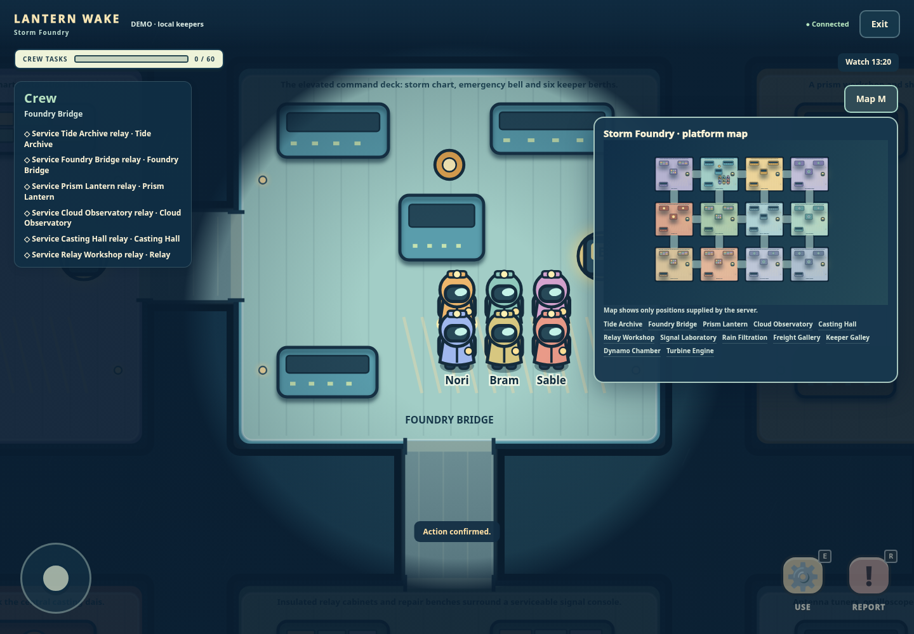
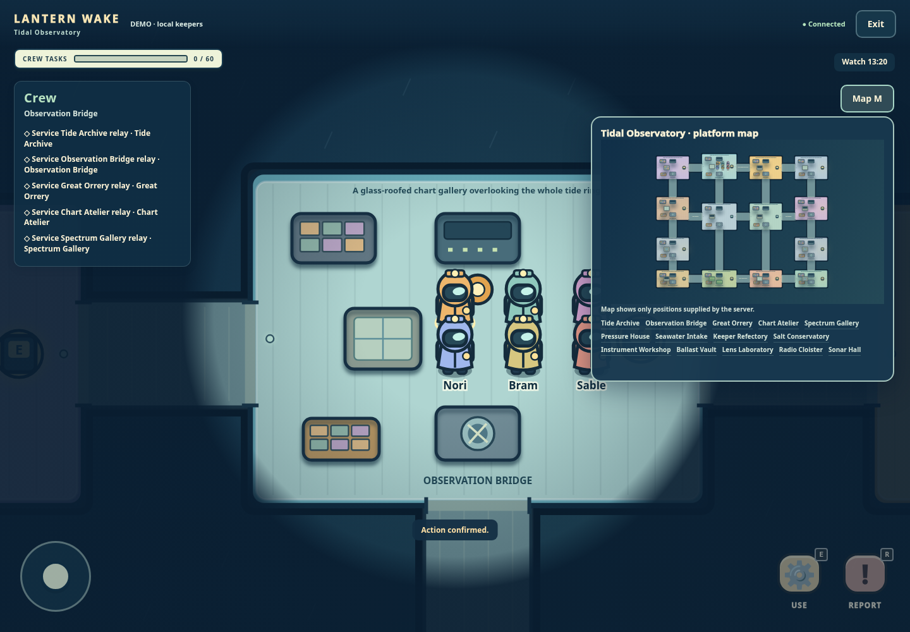
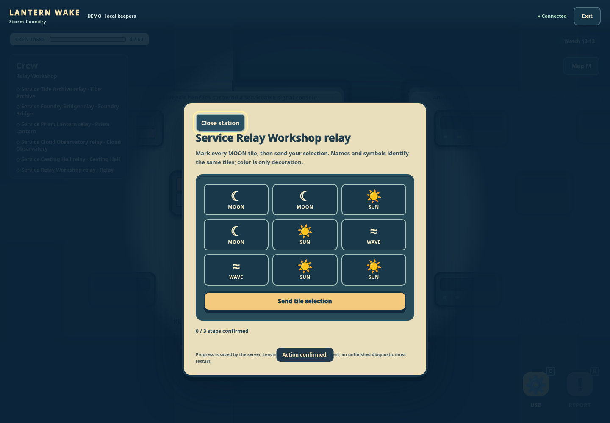
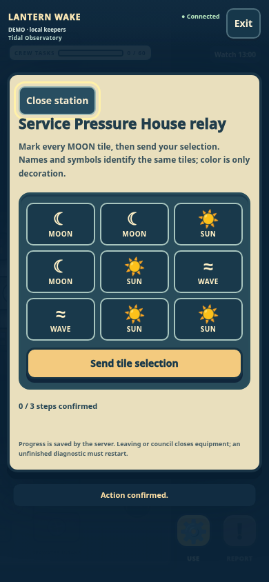

# Expanded maps and CAPTCHA equipment

The lobby map selector independently chooses the playing field before a match starts. The server validates and freezes that map, then applies that map's task and timing defaults. Hosts can still independently select ghost tasks and ability roles. Existing match data without a map ID restores on the original beacon, without migration.

| Map | Size in world units | Rooms | Crew assignments |
| --- | --- | --- | --- |
| Lantern Wake | 1600 × 1200 | 6 | Original 15 total |
| Storm Foundry | 3000 × 2200 | 12 | 60 total, 12 per crew keeper |
| Tidal Observatory | 3200 × 2500 | 14 | 60 total, 12 per crew keeper |

**Storm Foundry** uses seventeen looping passages between an industrial command deck, archives, casting hall, signal laboratory, filtration machinery, freight gallery and other themed rooms. Forty-eight solid props and thirty-six authored details give its floors distinct equipment and landmarks. [Full map notes](MAP-STORM-FOUNDRY.md).

**Tidal Observatory** connects fourteen rooms with nineteen corridors around a broad tide ring, twin instrument halls and long service spines. Seventy solid props and forty-six authored labels/lights distinguish charts, spectrum, intake, conservatory, ballast, lens, radio and sonar rooms. [Full map notes](maps/TIDAL-OBSERVATORY.md).

Both maps have six safe starting positions, reachable stations and an emergency bell. Walking uses the original speed, body radius, collision, line-of-sight and interaction rules. Solid machinery stays solid. Geometry/path caches are bound to a map, so two rooms or replay canvases can use different maps concurrently. Maps have eight-minute roam deadlines and a thirty-minute maximum by default; existing explicit numeric rule overrides are respected.

## More varied tasks

Each crew keeper on a new map receives twelve unique tasks, distributed across that map's rooms. Their explicit kinds cover all eleven puzzle families rather than choosing everything from six legacy room IDs. The original five station puzzles remain: wiring, tuning, sequence, pressure and timed repair.

The six additional CAPTCHA-style challenges are original local game equipment:

- **Glyph selection:** mark every matching symbol in a generated nine-tile grid.
- **Counting:** count the requested symbol among distractors.
- **Ascending order:** select generated number cards in increasing order.
- **Rotation:** choose the correction that turns a signal arrow north.
- **Odd one out:** find the unique symbol in a grid.
- **Code transcription:** type a generated six-character equipment code, using an unambiguous alphabet.

Challenges vary deterministically with the task identity and confirmed stage. Symbols include text labels; controls support keyboard and touch, retain focus, and show only server-confirmed progress. Stage inputs still use the existing bounded `taskStep` envelope and request receipts. Wrong inputs do not erase confirmed work. Direct completion without all stages rejects. A timed repair still requires its real server diagnostic deadline. [Task protocol](WORLD-TASKS.md), [CAPTCHA engine](CAPTCHA-TASKS.md), [CAPTCHA UI](CAPTCHA-PUZZLES-UI.md).

The client display helper describes the puzzle; it does not grant progress. These puzzles do not contact an external CAPTCHA service, purchase verification, call a provider or implement a website access gate.

## Integration and compatibility

`GAME_MAP` selects a server lobby default: `beacon`, `storm-foundry`, or `tidal-observatory`. `POST /api/rooms` and host-only `POST /api/rooms/:id/start` accept an optional `mapId`; invalid identifiers reject, spectators cannot change the start configuration, and an already accepted start is idempotent. Map selection does not change the established public room origin or authentication model.

New map matches store `mapId` in both room configuration and engine state. Saves check that these agree, tasks belong to that map, task IDs/totals are preserved and expanded tasks retain their explicit kinds. New task metadata uses version 2 with the same bounded progress keys; old version-1 station derivation and completed tasks stay readable. `features` and numeric rules remain separate from map selection.

Engine navigation, repairs, bodies, reports, AI plans and council room names all use the selected geometry. Fallen crew retain/complete their tasks in the optional ghost preset with the same private chat and living-only permissions. Ward/echo effects keep their normal ranges, cooldowns and chronological expiry. Hidden actor positions, task details and private chat remain filtered per recipient.

Replay histories retain their selected map and task kinds. Bounds, rooms, paths, effects, playback camera and historical perspective resolve per recording. Legacy replay map identifiers keep the original geometry. No global mutable current-map selection is used.

## Validation and images

See [recorded checks](MAPS-CAPTCHA-VALIDATION.md) for fixtures and initial results. The final integrated verification is recorded in [qualification](maps/qualification.md). Map browser fixtures use real app/HTTP/task actions, seeded crew assignments, accelerated movement time and idle demo scheduling; full-match integration tests separately exercise normal local bots and rule-based outcomes with no paid calls.

