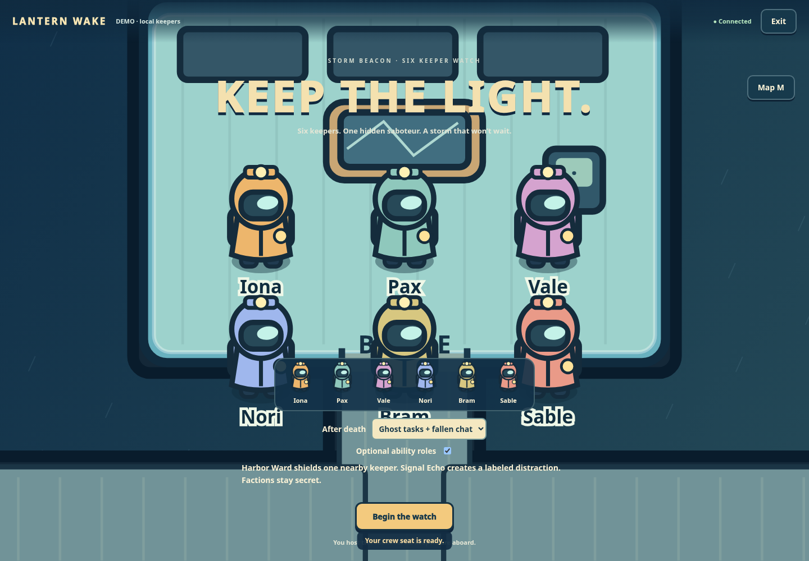
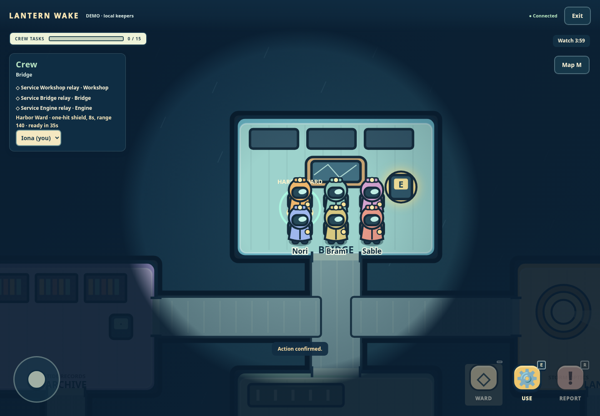
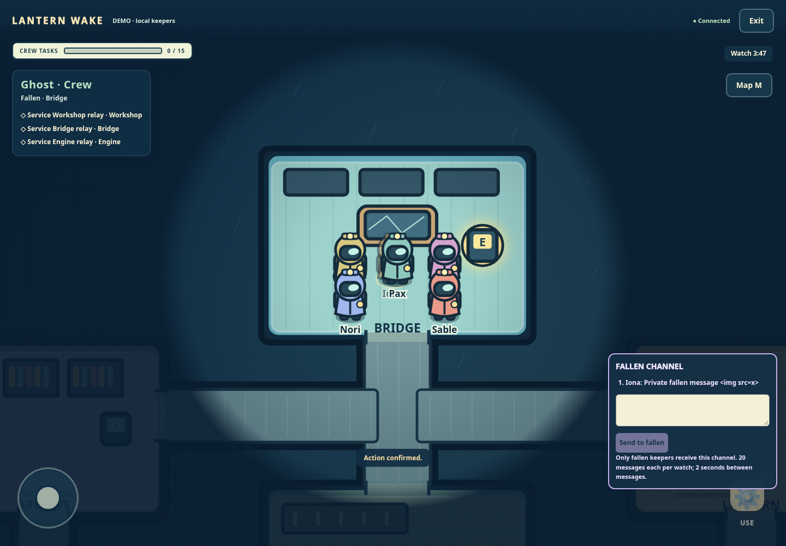
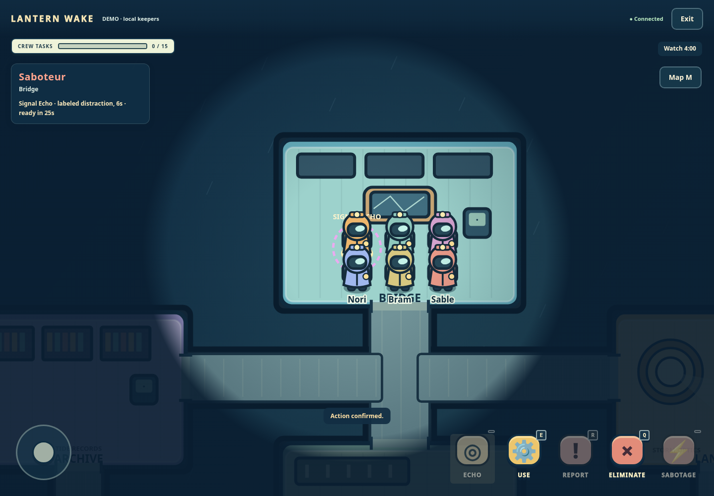

# Optional ghost watch and ability roles

The default remains **Transfer tasks (classic)** with ability roles disabled. At the pre-match lobby, the host can choose **Ghost tasks + fallen chat** and independently enable **Optional ability roles**. Begin the watch freezes both selections into the match. No lobby, task-system or model branch is required.

For server defaults:

```sh
GAME_DEATH_POLICY=ghost-tasks GAME_ABILITIES=true AI_PROVIDER=demo npm start
```

`GAME_DEATH_POLICY` accepts `transfer` or `ghost-tasks`. `GAME_ABILITIES` accepts `true` or `false`. The host may override defaults when starting a new room. Existing rooms keep their saved selection. No live API key is needed.

## Death and tasks

In new tactical watches, classic mode transfers unfinished jobs at meeting muster, preserving discovery-based death knowledge. Legacy world2 retains immediate transfer on elimination or ejection. Completed tasks remain with their owner. In ghost mode, fallen crew keep the same task objects, IDs and completed flags, and can finish them using ordinary **WASD/arrows/touch**, click navigation, stations and **E/USE** puzzles. There is no simultaneous transfer. The total task count and crew task victory calculation include these retained tasks. The game uses the server-authoritative `taskStep` protocol and completion action, with ownership, proximity, stage/input, diagnostic-time and cooldown validation. All five retained world2 puzzle types work for ghosts. New station match5 instead uses the six versioned taskInteract puzzles in QUALITY-RULES.md, with the same owner, proximity and lifecycle checks. Direct task completion without the required steps is rejected; the client puzzle grants no authority. Death retains confirmed steps but interrupts a running repair diagnostic, which resumes from its start-diagnostic stage.

Ghosts always remain `alive:false`. They are excluded from parity, living elimination targets, body reports, emergency calls, repair contributions, sabotage, abilities, discussion and votes. Meeting eligibility is living-only. They stop moving in council and terminal phases, as living keepers do; paths do not resume after council. Ghosts use the same speed, walls, line of sight, routes, input sequence receipts and movement leases. As physical deck occupants they jam a closing doorway without displacement; the generic jam state reveals no occupant identity. Their bodies retain their original independent death positions and times. Ejection creates no corpse.

Living views and public spectators receive `null` for a ghost's position and current room, including after the end. A ghost sees its own position and nearby permitted observations. Public body sightings refer to the stationary corpse, never the walking ghost. Ghost motion, task steps/actions and effect attribution are retained in the private, end-locked replay; replay exports remain chronologically sorted. No ghost chat is copied into replay or the public timeline.

**FALLEN CHANNEL** is available only to dead seated keepers in ghost mode, during active phases including council. It accepts up to 280 characters, 20 messages per sender per match, 120 total, and one message per sender every 2 seconds. Text is rendered literally. Successful/denied requests keep the existing lifetime action-id receipts. Messages are persisted privately and sent only in dead authenticated actors' HTTP/WS views. Living actors, anonymous/public spectators and spectator cookies never receive the channel, even after the match ends. A disconnected ghost restores its original cookie identity. Bots use only their own permitted view, send one labeled fallen message and finish retained tasks with deterministic local navigation. Ghosts never invoke strategic models. Confirmed step inputs and diagnostic waits use the same local policy as living crew.

## Harbor Ward and Signal Echo

When abilities are enabled, one randomly selected crew keeper receives **Harbor Ward**, and the saboteur receives **Signal Echo**. Assignment uses the seeded/random match generator after normal faction/task generation. `player.role` stays `crew` or `saboteur`; validated `player.ability` holds `{type,readyAt}`. Only one's own ability is returned in the live view.

| Rule | Harbor Ward | Signal Echo |
| --- | --- | --- |
| Owner | One crew keeper | Saboteur |
| Action | `protect {targetId}` | `decoy {x,y}` |
| Target | Any living keeper, including self and either faction | Walkable deck within 240 units and line of sight; UI drops at own current position |
| Range | 140 units, line of sight | 240 units, line of sight |
| Duration | 8 seconds, exclusive expiry | 6 seconds, exclusive expiry |
| Cooldown | 35 seconds from activation | 25 seconds from activation |
| Stacking | One ward per target; no refresh while active | One active echo per owner |
| Visibility | Nearby observers see a shield and target ID, without issuer or faction | Nearby observers see a ring labeled **SIGNAL ECHO**, without issuer, keeper ID or faction |
| Counter | Wait for expiry or spend one attack to consume it | Ignore the explicit distraction or wait for expiry |

Ward targeting checks only life, distance and visibility; a target's faction never changes success or response. A ward absorbs exactly one otherwise legal elimination. The attacker spends its normal elimination cooldown, the ward is consumed, and no death, body, task transfer, witness, parity change or invented accusation occurs. Retrying either activation or the blocked attack cannot repeat it. Ward does not prevent ejection or critical sabotage defeat.

An echo is a separate effect marker, never a forged keeper, body, payment, actual witness or win. It cannot block movement, perform tasks, report, vote, repair, sabotage, supply an eyewitness or alter faction/parity. Living demo crew may investigate a newly seen echo once, then return to ordinary work; urgent repair takes priority. The saboteur's remaining policy uses only safe visible targets.

Both abilities require a living owner in roam. Effects expire through the engine's chronological deadline loop, settling motion to each boundary before expiry. At an expiry timestamp the effect is already unavailable to a new action; tied effect expiries are processed before phase/critical deadlines. The existing critical-versus-maximum tie priority is preserved. Meetings clear all effects and stop movement; death clears effects issued by or targeting that keeper; pause/end clears all effects. Cooldowns keep their absolute timestamps through council, sabotage, death and restarts and never reset from a duplicate activation. Sabotage otherwise coexists with effects; a ward does not pause its countdown. Effects, action receipts, role assignment, chat and movement all persist with the room.

## Wire and storage contract

`POST /api/rooms` accepts optional `features:{deathPolicy,abilities}`. Host-only `POST /api/rooms/:id/start` accepts `{id,features?}`. The same start ID is inert after acceptance. Unknown keys/types/presets reject with `INVALID_FEATURES`; enabled features require world mode. `createMatch` receives `features` separately from the existing numeric `config` rules. No `ghostMode` boolean is silently accepted by the numeric parser.

Enabled matches store `features:{version:1,deathPolicy,abilities}`. Ghost mode adds `ghostChat`; abilities add `effects` and exactly one validated ward/echo assignment on the appropriate factions. The store validates bounds, timestamps, effect shapes/cooldowns/geometry, role association, unique task IDs/totals, chat sender/dead status and movement eligibility. Corrupt optional metadata is rejected/quarantined by normal persistence handling, not silently downgraded. Absent feature metadata keeps old schema-1/schema-2 saves and their previous semantics readable. All-classic new matches omit optional engine metadata.

Available-action hints include `ghostSay`, `protect`, and `decoy` only when the real authority would allow a candidate. They are convenience hints, not authorization. HTTP actions continue deriving the actor from the room cookie. WebSocket broadcasts continue constructing an individual safe view per authenticated recipient.

## Evidence and reproduction

```sh
npm ci
npm run check
TRANSPORT_TEST_TEMP="$PWD/_artifacts/test-temp" npm test
CHROME_PATH=/usr/bin/chromium npm run test:features:browser
CHROME_PATH=/usr/bin/chromium npm run test:browser
LW_WORLD_BROWSER=1 CHROME_PATH=/usr/bin/chromium node --test tests/world-ui-browser.test.mjs
```

For containers use the existing browser runners' no-sandbox flags or the cloud setup's Chromium helper. Tests never use a live provider. See [qualification](ghost-abilities/verification.md) for actual results and fixture limitations.





