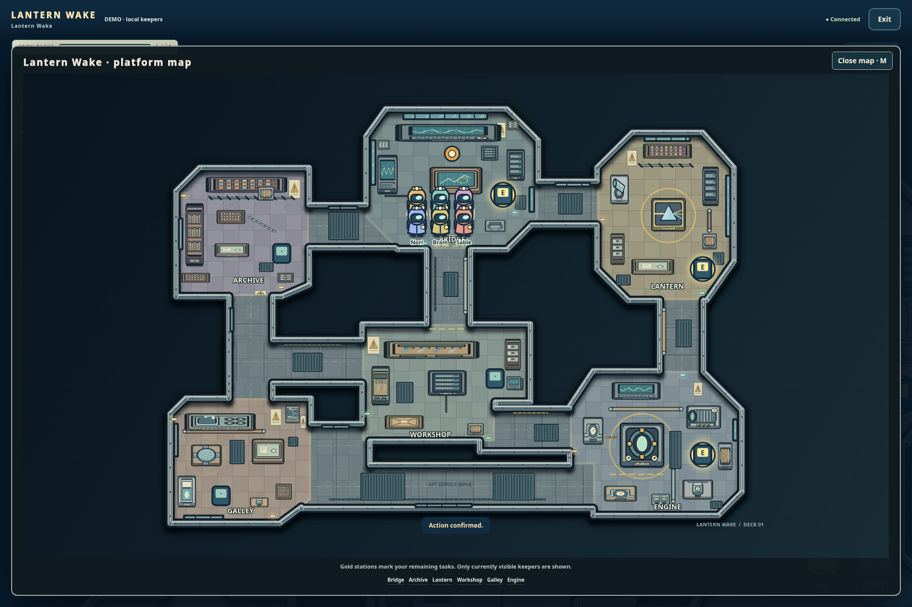
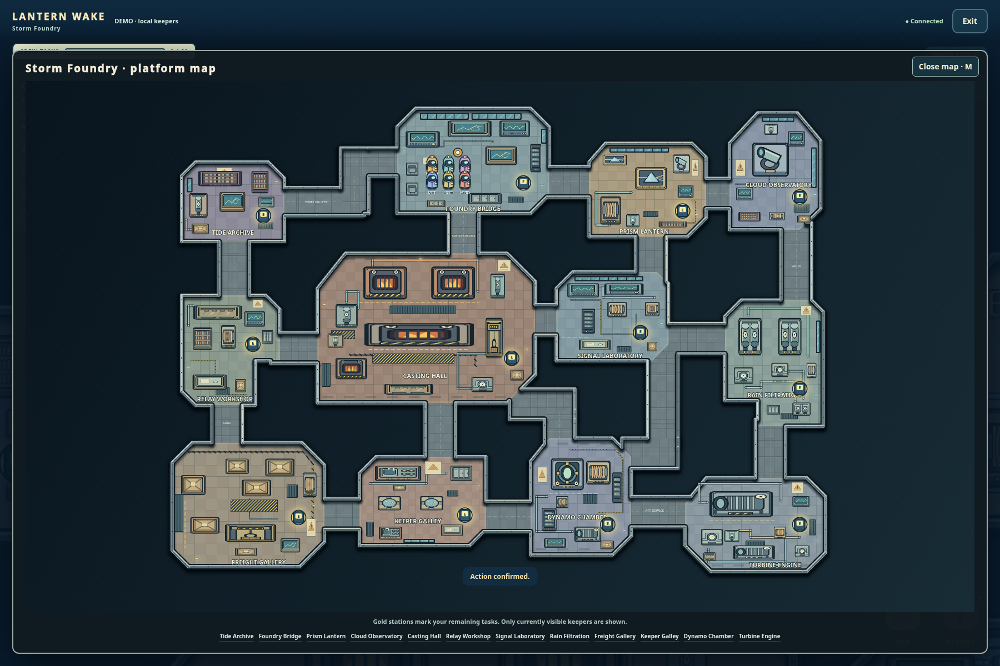
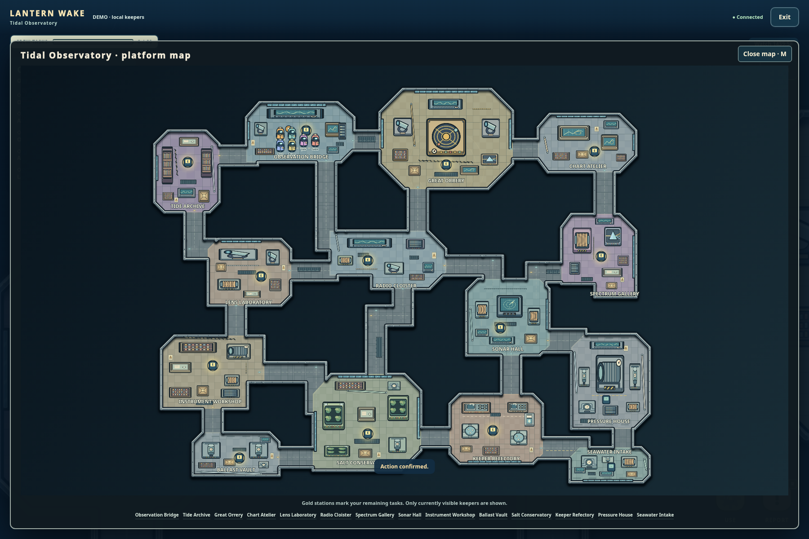
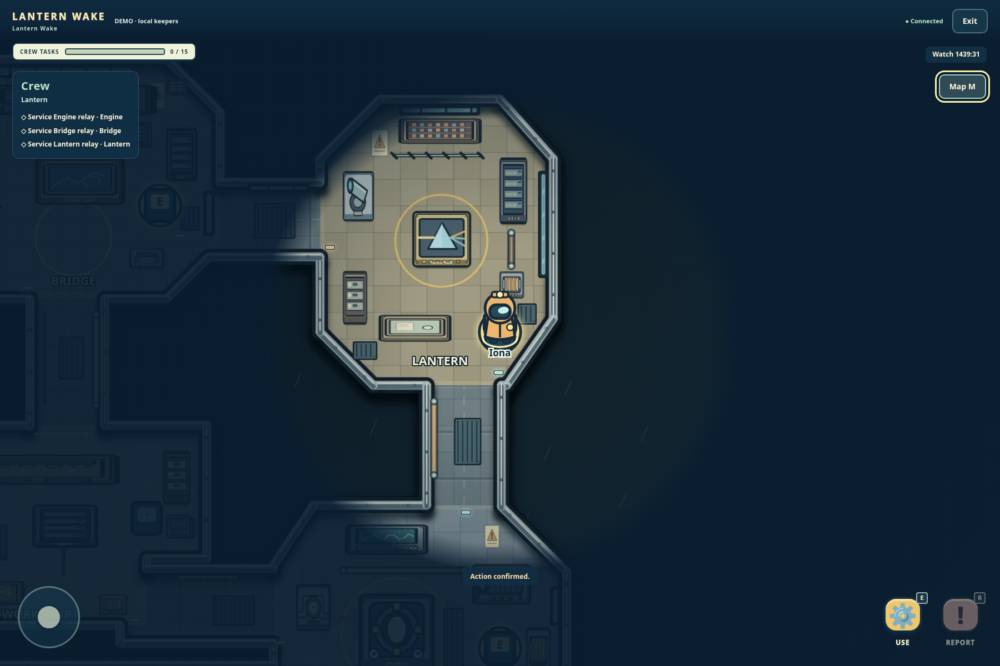
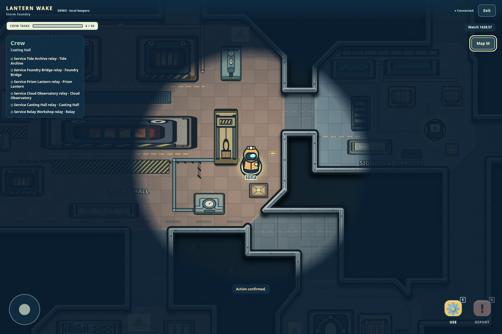
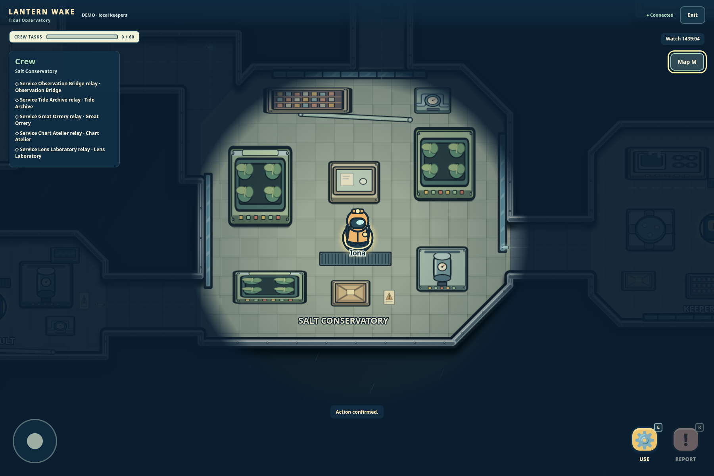

# Illustrated cutaway maps

All three maps have new original layouts and locally drawn, top-down cutaway artwork. The reference informed the visual direction: irregular room silhouettes, varied scales, purposeful corridor loops, recognizable equipment, floor materials, strong outlines and small environmental details. The game does not ship copied Among Us layouts or art.

Start a new watch, choose a map in the lobby, and enter the beacon. Press **M** for the complete platform map, **M** or **Escape** to close it, or use **Close map**. Walking uses the same physical deck visible in the artwork. Approach the highlighted station and press **E** or **USE** for equipment.

An already saved match or replay deliberately keeps its original layout. Exit that old room and create a new watch to see the redesign. The production server selects revision 2 for newly created rooms; reopening an old save never silently moves characters, corpses or task stations.

## Three distinct facilities

| Map | Rooms | Solid equipment footprints | Authored environmental marks | Crew assignments |
| --- | --- | --- | --- | --- |
| Lantern Wake | 6 | 44 | 86 | 15 total |
| Storm Foundry | 12 | 93 | 105 | 60 total |
| Tidal Observatory | 14 | 92 | 132 | 60 total |

**Lantern Wake** has an octagonal command gallery, projecting Fresnel-prism chamber, portside weather archive, L-shaped relay workshop, warm mess and stepped turbine room. The aft transfer walk and service links form routes around the machinery instead of a row of identical room boxes. Brass charts, weather cylinders, lens cases, a cooking line, two different dining tables, an alternator and pressure plumbing give the six rooms different purposes.



**Storm Foundry** is built around a large central casting hall with glowing furnace banks, an alloy channel, inspection gantry and safety markings. Its branching service walks connect the offset command deck, freight hold, optical and signal wings, rain filters, dynamo and twin turbine machinery. Cargo stacks, industrial tools, winding coils and steam equipment use different footprints and arrangements.



**Tidal Observatory** combines an eight-sided orrery crown, narrow vaulted archive, stepped spectral wing, angled acoustic chamber and glazed conservatory. The fourteen rooms form an asymmetric station around open tide wells, with an instrument workshop, trim tanks, copper-kettle refectory, tall pressure engine and shallow seawater intake. The armillary instrument, hydroponic beds, sonar display, telescope rails and draft tables remain recognizable in the complete map.



## Interior detail and physical rules

The cached vector floor layer paints tiled or paneled floors, inset hull edges, wall seams and rivets, glazed windows, floor grates, vents, cables, pipes, railings, technical plates, hazard bands, equipment labels and room-specific furniture. Solid equipment is drawn from the same footprints used for collision. The outer wall follows the union of the polygon rooms and corridors, so a visible open threshold is a real passage rather than a wall painted across a doorway. The small windows, grates, floor markings and cables are decorative; they do not invent hidden collision objects.

Every room has its own authored polygon outline. Chamfered corners and stepped alcoves change the physical floor; they are not a rectangular collision room behind a decorative image. Body-radius clearance, station proximity, visibility, speed, task authority, ghost permissions and ability ranges continue to use server-selected geometry. One-hit protection and the clearly labeled decoy retain their existing gameplay rules. Character positions still come only from the recipient's permitted view.





The visual change preserves task identities, task totals and all eleven puzzle families. Existing saves without `mapRevision` use revision 1; new rooms persist revision 2 through engine state, room configuration, safe views and spatial replay metadata. Numeric rules and feature presets remain separate. Clients cannot choose another revision through an action. A replay selects the recording's geometry rather than the current lobby's layout.

## Recorded qualification

The [final integrated validation record](illustrated-maps/validation.md) includes the complete 621-test suite, all six browser suites and independent execution of every directed station pair.

`tests/illustrated-maps-geometry.test.mjs` and `tests/illustrated-maps-demo.test.mjs` passed **10 tests**. An independent polygon/collider flood checks every station, bell and spawn, and checks route segments against physical walls. All three safe-view demo simulations perform real server-confirmed task work, survive JSON restart and reach rule-based victories without provider calls. Separate cases move a dead crew member through each new layout while preserving the corpse position and filtering the ghost from living/public views. Revision-1 geometry remains independent.

Run the dedicated browser qualification with an installed Chrome/Chromium:

```sh
CHROME_PATH=/path/to/chromium node scripts/illustrated-maps-browser-check.mjs
```

The final run passed **65 browser checks**, toured **all 32 rooms** using actual authenticated navigation, and retained **50 screenshots**. Native equipment completed through the existing server stages on each map; completion survived reload. The fixture verifies collisions, spectator filtering, mobile layout, **M/Escape** closing the map and restoring movement controls, and unchanged hashes of every runtime `.mjs`, `.css` and `.html` file in `public`, `shared` and `server`. There were no page errors. The three console errors were the deliberate HTTP 409 attempts to navigate into solid machinery, one per map.

This is a seeded, accelerated offline fixture using the real app, cookies, HTTP, engine and persistent store with explicitly idle demo bots. It does not fabricate responses, task completion or victory. Full-match simulations separately run the normal local bot policy. No paid/live provider call, third-party CAPTCHA service or deployment is part of qualification.

The retained report is [browser-qualification.json](illustrated-maps/browser-qualification.json). All fifty screenshots and the private fixture data remain under `_artifacts/illustrated-maps-browser-TtKyH6/` in the cloud checkout; the selected images here are actual app captures. Earlier failed qualification artifacts are kept separately and are not counted as passing evidence. Their findings led to wider equipment access, a tiny revision-2 collision tolerance for floating-point boundary rounding, and correct map-dialog movement restoration.

Mobile examples: [Lantern Wake](illustrated-maps/beacon-mobile.png), [Storm Foundry](illustrated-maps/storm-foundry-mobile.png), [Tidal Observatory](illustrated-maps/tidal-observatory-mobile.png).
