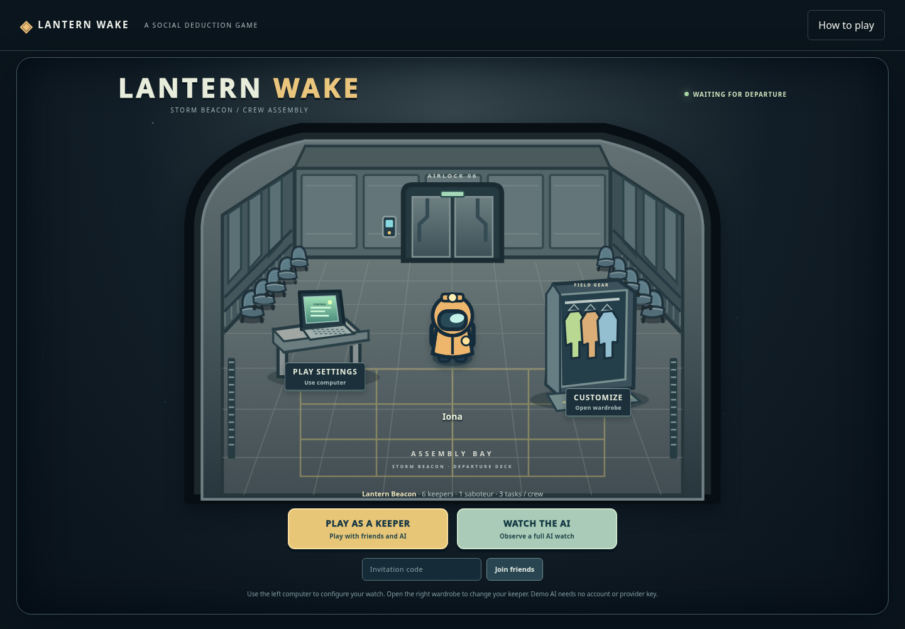

# Main integration validation — 2026-10-30

**Application and browser qualification source: `242bed32a64c1f6dd5b771adb5aecf1f507504c8`.** This includes main `af820b59b9613643a0462c4a517886cd796e316b` and the preserved multiplayer/task branch `78677ec`. All implementation files stayed unchanged throughout the final twelve-gate browser run. Later evidence/documentation commits do not change the application.

Six requested agents covered engine, AI, rooms/storage, client, replay and independent QA. The integration retains current main’s tactical systems, authored station challenges, investigations, strategic controller, ghost/ability policies, map revisions, movement caches, council focus rules and replay behavior. No file from current main was deleted.

## Final verification

| Gate | Actual result |
| --- | --- |
| `npm ci --ignore-scripts --no-audit --no-fund --cache /workspace/.npm-cache` | 25 packages installed; dependency declarations and integrity checks preserved. |
| `npm run check` | **349 JavaScript modules syntax checked.** |
| `npm test` | **1,767 tests: 1,761 passed, 6 existing optional skips, 0 failed, 0 cancelled.** |
| Maximum supported task persistence | **5/5 maps:** 15 keepers, 1 saboteur, 20 tasks per crew, 280 total tasks; real HTTP start, exact bytes/state after disk reload, no quarantine. |

Browser gates ran sequentially with `CHROME_PATH=/workspace/.cloud-setup/bin/chromium-cloud`; the independent UI gate also sets `LW_WORLD_BROWSER=1`.

| Command | Actual result | Coverage |
| --- | --- | --- |
| `npm run test:browser` | 34 checks passed | Production mixed-task gameplay |
| `npm run test:task-browser` | 42 checks passed | Historical five-puzzle gameplay |
| `npm run test:beacon-browser` | 13 checks passed | Legacy beacon systems |
| `npm run test:tactical-browser` | 32 checks passed | Both tactical maps |
| `npm run test:tasks:browser` | 98 checks passed | All 25 task families |
| `npm run test:multiplayer-browser` | 26 checks passed | Two humans plus spectator |
| `npm run test:maps:browser` | 39 checks passed | Expanded maps / historical CAPTCHA |
| `npm run test:illustrated:browser` | 68 checks passed | All illustrated revisions |
| `npm run test:spectator:browser` | 51 checks passed | Spectator privacy and inspection |
| `npm run test:features:browser` | 19 checks passed | Ghosts and optional abilities |
| `npm run test:spatial-browser` | 21 checks passed | Spatial replay |
| `node --test tests/world-ui-browser.test.mjs` | 19 checks passed | Independent world UI |

All **12 gates / 462 checks passed**, with zero page exceptions. Expected negative API responses remain recorded separately. Lifecycle audits inspect every available response and record genuinely closed-consumer cancellations separately; an unavailable body is not claimed inspected. See the individual reports for counts and fixture limits.

[Qualification manifest](integration-main/reports/qualification.json) · [Full test output](integration-main/reports/unit.txt) · [Syntax output](integration-main/reports/syntax.txt) · [Install output](integration-main/reports/install.txt) · [Maximum-size persistence](integration-main/reports/max-settings.json)

## Integrated behavior and compatibility

- `/` opens the original gray assembly room with a computer on a small left table, wardrobe on the right, Play/Watch AI controls and invitations. Settings/profile drafts are applied through authenticated APIs, and partial setup errors remain visible in the retained room.
- Configured watches support 4–15 canonical actors, 1–3 saboteurs with a crew majority, multiple authenticated humans, unclaimed AI seats, readiness, host controls and distinguishable numbered raincoats. New visitors to active watches remain spectators. Every HTTP mutation and WebSocket projection resolves current identity ownership.
- New production room container **5** keeps public numeric settings separate from private `mapSettings` receipts. Historical room containers 1–4, prior configurable container 2, match formats 1–5 and exact tactical/world-map namespaces remain readable. Valid historical saves are not rewritten or quarantined. Explicit legacy systems creation remains supported, while ordinary root creation uses the selected map.
- Illustrated watches use the 25-family equipment/CAPTCHA catalogue; tactical watches blend it with authored stations. Equipment-only excludes glyph inspection and modern CAPTCHA. Historical progress formats remain exact. Timers, wrong answers, input ordering, interruption and two-station power routing are enforced by the server.
- Settings are per match and lock at start. Speed/vision, safe spawns, prediction, player IDs, bodies, provider snapshots and replay support p10–p15 without changing another room’s geometry or defaults.
- Rematches retain group/invitation/profiles while creating a fresh generation, role assignment, inputs/actions and AI context. Old requests, frames, queued AI/provider work and reservation callbacks are fenced. Deployment-day spending and uncertain reservations remain durable.
- Completed replay archives are bounded privately. Eviction selects checkpoints covering **all discarded sequence numbers and timestamps**, or reports partial unknown history. Anchorless 15-actor archives never invent final positions. A real 2,100-action, 15-actor HTTP rematch/save/reload regression covers this boundary.
- Default projections remain role-private. Explicit role-revealing inspection is available only to the authenticated, seatless host of an all-AI watch; mixed-human rooms and other visitors are denied, and rematches reset consent.

## Meaningful audit corrections

The initial in-progress integration run had 1,721 tests: 1,686 passed, 29 failed and 6 skipped. It was a diagnostic run while integration was still changing, not qualification of a frozen commit. Corrections retained real assertions: old six-only/future-schema fixtures now test the new deliberate bounds; map receipt tests distinguish private ledgers from public settings; older task and station modes remain explicitly covered.

Actual defects corrected include historical custom-ID spawn ordering, missing modern task-opening hints for AI, per-match client prediction and numbered badges, named legacy room creation, stale partial-setup feedback, unintended saved-map upgrades, replay coverage after chronological eviction/backdated arrivals, legacy systems startup and synchronous map-control redraw. Six new map-toggle cases fail before the redraw fix and pass with only one initial snapshot, covering human/spectator views on every illustrated map and retaining council Escape priority.

A 15-actor, three-saboteur AI fixture completes all 48 mixed jobs through real task actions after a JSON restart. Attacks were explicitly disabled/delayed to isolate task completion; this is not a claim that every default combat watch has that outcome. No provider request was sent.

Browser fixtures were adapted to actual map-specific assignment buttons, connected-state readiness and explicit inspection consent. The retained beacon compatibility gate creates an unmapped room with the supported native HTTP API, then uses the real lobby/game UI. The production mixed-task gate still uses the root launch UI. The 25-family panel fixture selects a task family before start, uses an isolated production-panel host with safe owner snapshots and real HTTP actions, and travels legally between power stations. It does not pretend random generation gave one keeper every family. No gameplay assertion was disabled or replaced with a fabricated winner.

Intermediate browser failures are retained as red receipts under [reports/intermediate](integration-main/reports/intermediate/README.md). Original main feature evidence remains intact.

## Current screenshots

[Gray waiting room](integration-main/screenshots/tasks-01-waiting-room-desktop.png) · [Settings computer](integration-main/screenshots/tasks-02-watch-computer.png) · [Wardrobe](integration-main/screenshots/tasks-03-wardrobe.png) · [320px lobby](integration-main/screenshots/tasks-04-waiting-room-mobile-320.png) · [15-player lobby](integration-main/screenshots/multiplayer-01-configurable-lobby-15.png)

[Wiring](integration-main/screenshots/tasks-05-panel-wires.png) · [Code CAPTCHA](integration-main/screenshots/tasks-05-panel-code.png) · [Sample analyzer](integration-main/screenshots/tasks-05-panel-sample.png) · [Waveform CAPTCHA](integration-main/screenshots/tasks-05-panel-frequency.png) · [Mobile path CAPTCHA](integration-main/screenshots/tasks-06-mobile-path.png) · [Host controls](integration-main/screenshots/multiplayer-07-active-host-controls.png)

## Setup and external limits

Use the existing Cloud checkout and Node24. Run checks sequentially: the unit suite creates/removes temporary test directories, so concurrent syntax scanning can race cleanup. Fetch all remote heads for pinned historical audit sources. Browser fixtures own and clean up their servers, browser profiles and data; they are not deployment.

Live Among Us wiki retrieval remains blocked by network-policy 403 responses; [reference notes](TASK-REFERENCE-RESEARCH.md) distinguish prior knowledge from retrieved sources. These are original adapted mechanics, not a claim of exact Among Us parity. The GitHub API also returned 403 during this task; native Git fetch/push works. The saved Cloud draft requests the required hosts and preserves reusable setup; draft saving does not activate or publish policy. Merge delivery is reported only after the remote operation is confirmed. No deployment, paid provider call, installer, signing or voice change occurred.
