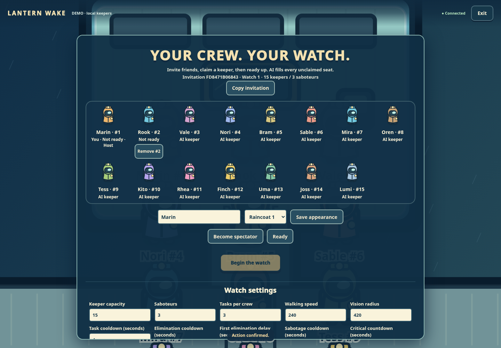
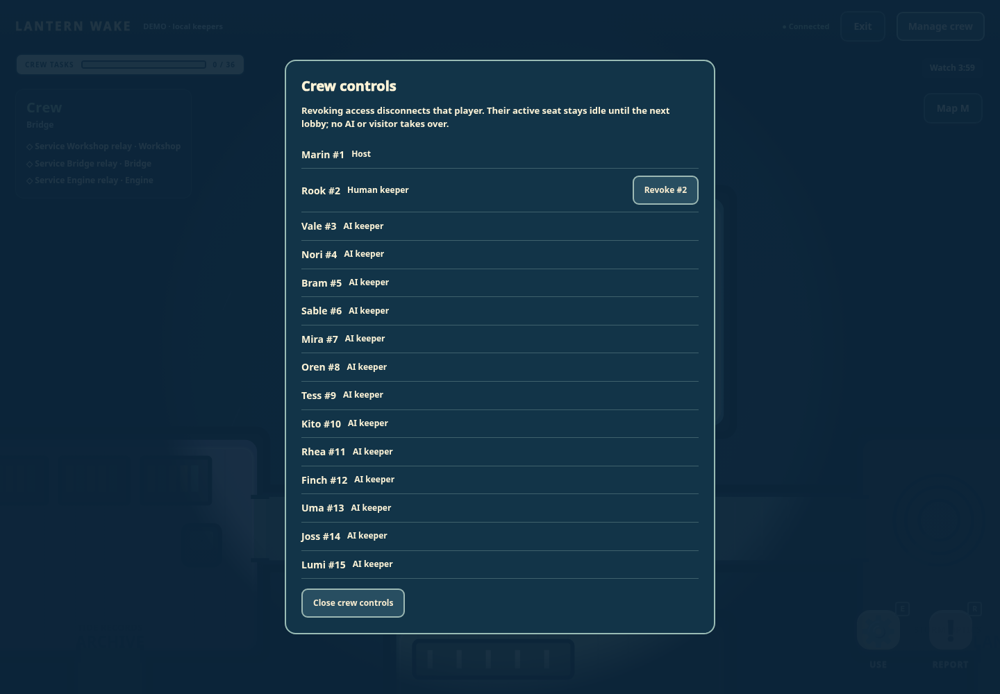

# Multiplayer qualification

## Follow-up audit — 2026-10-30

Final runtime source: clean commit `61200029fafb7e3ab5a85beed785aa69bbe64bcf`, incorporating main `22340f0dd92fb312f01bc7a14d406541dab9ce09` (including `fa7aaa0` task/ghost/ability integration). All suites below ran sequentially against that committed source. No runtime source changed during qualification. This evidence update changes documentation and screenshots only. The [audit findings and request matrix](MULTIPLAYER-AUDIT.md) list the fixes and coverage. The original qualification below remains historical evidence, not the current result.

| Command | Observed result |
| --- | --- |
| `npm ci --ignore-scripts --no-audit --no-fund --cache /workspace/.npm-cache` | 25 packages installed successfully. A plain `npm ci` attempt could not create the protected home-directory cache; the configured writable Cloud cache resolves it. Manifests/lockfile unchanged. |
| `npm run check` | 111 JavaScript modules syntax checked. |
| `npm test` | 543 tests: **537 passed, 6 skipped, 0 failed, 0 cancelled**. Existing optional skips remain separate from passes. |
| `CHROME_PATH=/workspace/.cloud-setup/bin/chromium-cloud npm run test:browser` | **42 checks passed**, including five authoritative puzzles, human/AI and all-AI matches, council, mobile, role privacy, victory/replay and unchanged source hashes. Only intentional direct-finish 409 console rejections occurred. |
| `CHROME_PATH=/workspace/.cloud-setup/bin/chromium-cloud LW_WORLD_BROWSER=1 node --test tests/world-ui-browser.test.mjs` | **1 test / 19 checks passed**; server/browser closed, owned fixture data removed, clean source `6120002` confirmed. |
| `CHROME_PATH=/workspace/.cloud-setup/bin/chromium-cloud npm run test:multiplayer-browser` | **26 checks passed**, using two independent human browser contexts and a spectator; 15-player configuration, ghost/ability presets, appearance, independent movement, reconnect, three-saboteur outcome, archived replay/rematch and host revocation. |
| `CHROME_PATH=/workspace/.cloud-setup/bin/chromium-cloud npm run test:features:browser` | **19 checks passed**, including real ward/echo actions, playable ghost input/tasks, private fallen chat, spectator redaction and mobile controls. |

All four browser suites reported zero page exceptions. The gameplay and independent UI reports verify the runtime source stayed unchanged. Full reports are retained at [world gameplay](multiplayer-audit/world-browser.json), [independent world UI](multiplayer-audit/world-ui-browser.json), [multiplayer](multiplayer-audit/multiplayer-browser.json), and [ghost/abilities](multiplayer-audit/ghost-abilities-browser.json). Their private artifact paths identify the original fixture captures; selected portable screenshots are linked below. No paid calls, main changes or deployment occurred.

Additional audit coverage includes every valid capacity/faction ratio; legacy named creation; idempotent full-lobby claims; authorization of repeated rematches; deferred old client operations; immediate revoked-input controls; disabled-bell AI behavior; shared-address human movement; late durable budget callbacks; 15-player ghost/ability persistence and rematches; and a real strategic p15 controller with a mocked provider fenced through a two-human rematch. The merged strategic suites retain their original 24-entry prompt stress test, current-view/phase/death fences and optional-strategy labels. The production game remains capped at 15 keepers.

The first task/ghost merge exposed a fixture that tried direct world-task completion; it now submits real semantic task steps and respects diagnostic time. The later strategic merge exposed an internal helper default incompatible with legacy room fixtures; `createRooms` now preserves legacy defaults unless configurable mode is explicitly enabled. Production transport enables it for new world rooms. Required checks were rerun after the final integration; failures were corrected without disabling assertions or weakening schema validation.

Main was re-fetched and checked before handoff. The branch preserves all merged main task, ghost and strategic documentation/reports/screenshots. Creating a PR remains blocked because the enforced Cloud network policy excludes `api.github.com`; Git fetch/push works. A draft allowing that API domain and a prepared PR body are saved. A saved draft does not apply or publish the environment configuration.

### Audit screenshots

[15-keeper desktop lobby](screenshots/multiplayer-audit/01-configurable-lobby-15.png) · [Host settings and feature presets](screenshots/multiplayer-audit/01b-host-settings.png) · [Mobile guest lobby](screenshots/multiplayer-audit/02-guest-lobby-mobile.png) · [Host world](screenshots/multiplayer-audit/03-multiplayer-world.png) · [Second human controls](screenshots/multiplayer-audit/03b-second-human-controls.png) · [Completed match](screenshots/multiplayer-audit/04-completed-match.png) · [Rematch lobby](screenshots/multiplayer-audit/05-rematch-lobby.png) · [Fresh role](screenshots/multiplayer-audit/06-fresh-role-assignment.png) · [Active host controls](screenshots/multiplayer-audit/07-active-host-controls.png)

## Original qualification — 2026-10-29

Tested in the Cloud workspace on 2026-10-29 using Node 24.19.0, npm 11.9.0 and Chromium 154.0.8037.57. This original run incorporated main `90bb6e881f75f77e85b8b49729971a710b4c91b4`. Implementation commits are `c03f7ed` (backend/ownership/persistence) and `70e0e67` (UI/client/qualification/documentation). This record and screenshots add no runtime changes. Existing historical audit reports and metadata are preserved.

| Command | Observed result |
| --- | --- |
| `npm ci --ignore-scripts --no-audit --no-fund --cache /workspace/.npm-cache` | 25 packages installed; dependency manifests and lockfile consistent. |
| `npm run check` | 96 JavaScript modules syntax checked. |
| `npm test` | 444 tests: 438 passed, 6 skipped, 0 failed, 0 cancelled. Optional disabled audit/browser suites remain distinguishable from passes. |
| `CHROME_PATH=/workspace/.cloud-setup/bin/chromium-cloud npm run test:browser` | 26 checks passed; human-plus-AI and all-AI games, three task puzzles, council, privacy, mobile layout, victory and replay. No browser or console errors; runtime hash check passed. |
| `CHROME_PATH=/workspace/.cloud-setup/bin/chromium-cloud LW_WORLD_BROWSER=1 node --test tests/world-ui-browser.test.mjs` | 1 test / 19 checks passed; real server, movement leases, touch, tasks, focus, voting, bodies, critical sabotage, replay and cleanup. |
| `CHROME_PATH=/workspace/.cloud-setup/bin/chromium-cloud npm run test:multiplayer-browser` | 18 checks passed with two independent human cookie contexts and one spectator. No browser exceptions. |

The final suites ran sequentially. The full-game report was captured against the implementation working tree immediately before its commits (its metadata records baseline `90bb6e8` plus those modified paths); the independent world UI report records clean commit `70e0e67`. No runtime source changed during browser qualification. Generated private reports remain under `_artifacts/world-browser-PE9pWC/`, `_artifacts/world-ui-75oAkn/`, and `_artifacts/multiplayer-browser-ofk1q5/` in this Cloud workspace. Selected screenshots below are committed so review does not depend on those ignored directories.

New automated coverage verifies 4/6/15 seat claims, persistence and reload; p10–p15 identities and bodies; concurrent joins/readiness/start; individual human authority; exclusion of humans from AI scheduling; HTTP and WebSocket role privacy including private multi-saboteur teammate knowledge; re-resolved, reassigned and revoked sockets; reconnects; all-saboteur ejection and parity; old input/action/retry/provider/reservation fences; fresh rematch context; preserved deployment-day reservations; bounded private completed replays; and valid historical legacy/world checkpoints without migration or quarantine. Client tests execute actual lifecycle functions with deferred old responses.

The multiplayer browser fixture runs real HTTP/WS and frontend modules. Its clock and idle local AI are explicit test fixtures; it uses legal engine votes for AI seats to finish council. It does not fabricate outcomes and does not claim live-provider or production-load qualification. No paid calls, direct commits to main, or deployment occurred.

During integration, the existing full-game browser assertions were updated for the new generation/match metadata; the independent UI selectors now use stable start/actor targets rather than the first primary button or ambiguous names. A fixed 19-second clock jump could skip the voting window after screenshot/reload work, so it now advances to the actual discussion deadline. Initial failing attempts are superseded by the successful runs above; no assertion or required suite was disabled.

## Retained screenshots

[Desktop 15-keeper lobby](screenshots/multiplayer/lobby-desktop.png) · [Host settings](screenshots/multiplayer/host-settings.png) · [Mobile guest lobby](screenshots/multiplayer/lobby-mobile.png) · [Two-human world](screenshots/multiplayer/two-human-world.png) · [Completed watch](screenshots/multiplayer/completed-watch.png) · [Rematch lobby](screenshots/multiplayer/rematch-lobby.png) · [Fresh role reveal](screenshots/multiplayer/rematch-role.png)

