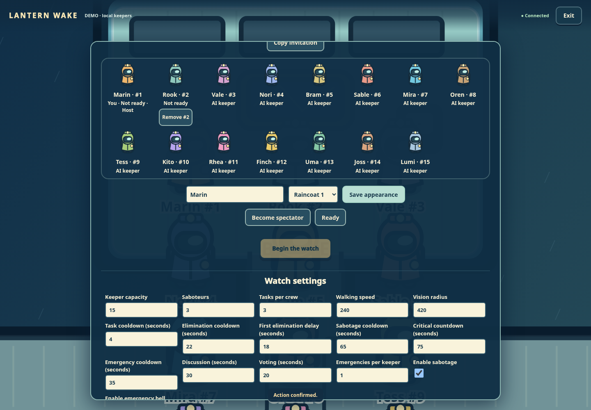
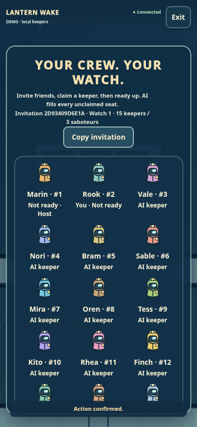

# Multiplayer qualification

Tested in the Cloud workspace on 2026-10-29 using Node 24.19.0, npm 11.9.0 and Chromium 154.0.8037.57. The branch incorporates current main `90bb6e881f75f77e85b8b49729971a710b4c91b4`. Implementation commits are `c03f7ed` (backend/ownership/persistence) and `70e0e67` (UI/client/qualification/documentation). This record and screenshots add no runtime changes. Existing historical audit reports and metadata are preserved.

| Command | Observed result |
| --- | --- |
| `npm ci --ignore-scripts --no-audit --no-fund --cache /workspace/.npm-cache` | 25 packages installed; dependency manifests and lockfile consistent. |
| `npm run check` | 96 JavaScript modules syntax checked. |
| `npm test` | 444 tests: 438 passed, 6 skipped, 0 failed, 0 cancelled. Optional disabled audit/browser suites remain distinguishable from passes. |
| `CHROME_PATH=/workspace/.cloud-setup/bin/chromium-cloud npm run test:browser` | 26 checks passed; human-plus-AI and all-AI games, three task puzzles, council, privacy, mobile layout, victory and replay. No browser or console errors; runtime hash check passed. |
| `CHROME_PATH=/workspace/.cloud-setup/bin/chromium-cloud LW_WORLD_BROWSER=1 node --test tests/world-ui-browser.test.mjs` | 1 test / 19 checks passed; real server, movement leases, touch, tasks, focus, voting, bodies, critical sabotage, replay and cleanup. |
| `CHROME_PATH=/workspace/.cloud-setup/bin/chromium-cloud npm run test:multiplayer-browser` | 18 checks passed with two independent human cookie contexts and one spectator. No browser exceptions. |

The final suites ran sequentially. The full-game report was captured against the implementation working tree immediately before its commits (its metadata records baseline `90bb6e8` plus those modified paths); the independent world UI report records clean commit `70e0e67`. No runtime source changed during browser qualification. Generated private reports remain under `_artifacts/world-browser-PE9pWC/`, `_artifacts/world-ui-75oAkn/`, and `_artifacts/multiplayer-browser-ofk1q5/` in this Cloud workspace. Selected screenshots below are committed so review does not depend on those ignored directories.

New automated coverage verifies 4/6/15 seat claims, persistence and reload; p10–p15 identities and bodies; concurrent joins/readiness/start; individual human authority; exclusion of humans from AI scheduling; HTTP and WebSocket role privacy including private multi-saboteur teammate knowledge; re-resolved, reassigned and revoked sockets; reconnects; all-saboteur ejection and parity; old input/action/retry/provider/reservation fences; fresh rematch context; preserved deployment-day reservations; bounded private completed replays; and valid historical legacy/world checkpoints without migration or quarantine. Client tests execute actual lifecycle functions with deferred old responses.

The multiplayer browser fixture runs real HTTP/WS and frontend modules. Its clock and idle local AI are explicit test fixtures; it uses legal engine votes for AI seats to finish council. It does not fabricate outcomes and does not claim live-provider or production-load qualification. No paid calls, direct commits to main, or deployment occurred.

During integration, the existing full-game browser assertions were updated for the new generation/match metadata; the independent UI selectors now use stable start/actor targets rather than the first primary button or ambiguous names. A fixed 19-second clock jump could skip the voting window after screenshot/reload work, so it now advances to the actual discussion deadline. Initial failing attempts are superseded by the successful runs above; no assertion or required suite was disabled.

## Retained screenshots

[Desktop 15-keeper lobby](screenshots/multiplayer/lobby-desktop.png) · [Host settings](screenshots/multiplayer/host-settings.png) · [Mobile guest lobby](screenshots/multiplayer/lobby-mobile.png) · [Two-human world](screenshots/multiplayer/two-human-world.png) · [Completed watch](screenshots/multiplayer/completed-watch.png) · [Rematch lobby](screenshots/multiplayer/rematch-lobby.png) · [Fresh role reveal](screenshots/multiplayer/rematch-role.png)

