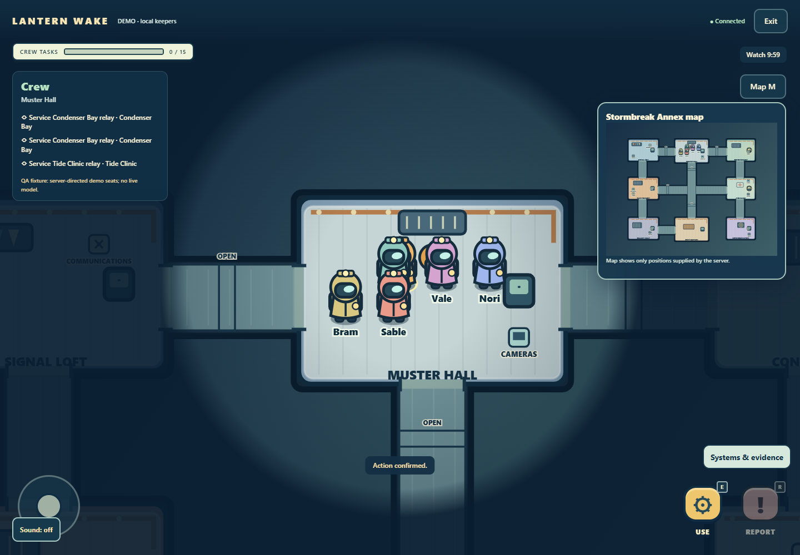
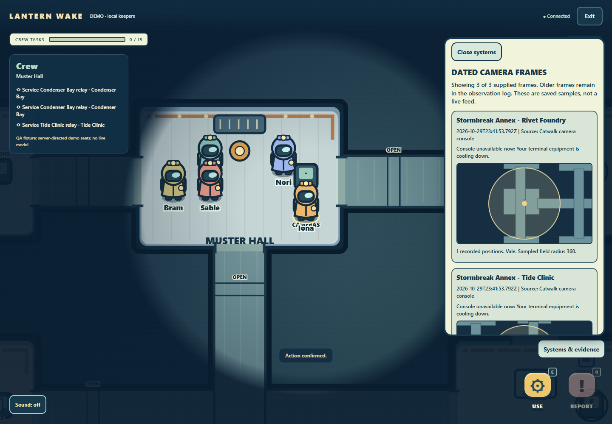
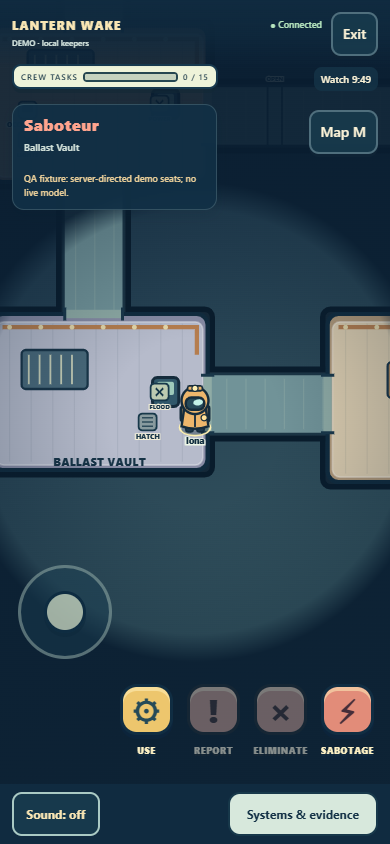
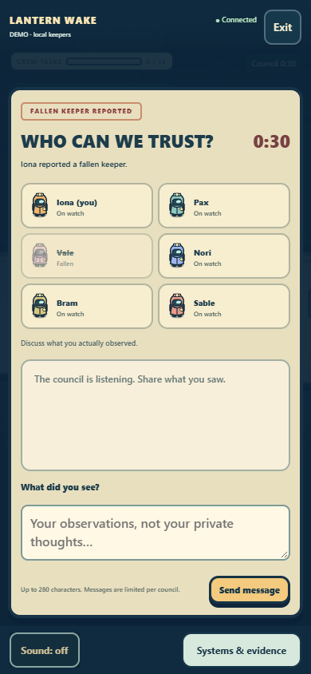

# Tactical expansion verification

The additional Group1 phase starts from actual origin/main **90bb6e881f75f77e85b8b49729971a710b4c91b4** and preserves completed Group1 **559e135a5aa8fff26b93cb7151df2867d0f44fcf** (PR4) by merge into **codex/tactical-annex-20261029**. Neither main nor the prior task branch is edited. All builders use isolated D: worktrees. No Group2 branch was imported; current main is rechecked before handoff.

## Implementation map

| Owner | Implementation | Actual integration |
| --- | --- | --- |
| Coordinator | Schema4/map settings, strict restoration, public projections, AI navigation, root cancellation, launch/CI | shared/tactical.mjs; server/config.mjs; engine/index.mjs; rooms/map-settings/store/transport; public/app.mjs; existing feature services |
| Core | Immutable map registry, original eight-room Stormbreak Annex, geometry/spawns, sight, path invalidation | shared/maps/**; server/engine/world/**; map-specific runtime selected before task creation |
| Systems | Faction-shared sabotage, warning/closed/jammed doors, power/flood, maintenance passages | server/engine/systems/** through ordinary validated actions and chronological engine deadlines |
| Investigation | Scoped cameras, anonymous occupancy, private vitals and dated owner evidence | server/engine/investigation/** through same clock/permission checks and private HTTP/WS views |
| Client | Real map selector, both maps/art, equipment and dated camera cards, native controls and opt-in sound | public/world/** through existing app routes/settings/actions/input and modal ownership |

The tactical preset supports one critical plus lights/comms and at most two pending/closed/jammed door attempts. Living saboteurs alone may use linked passages. Repair requires distinct living crew at actual map-specific sites. Server-side sight, dynamic collision, unknown deaths and private observations apply before serialization. See [rules](TACTICAL-RULES.md) and [executable interfaces](TACTICAL-INTERFACES.md).

## Launch

On the development machine:

```powershell
cd D:\Widegames-work\tactical-annex-coordinator-20261029
npm ci
npm start
```

Open http://localhost:3000 in a browser. Keep the terminal running. Choose human or all-AI, select a map in the host lobby, then begin and acknowledge the private role. The default is visibly labeled local demo, with no credentials required. If port3000 is occupied, stop the previous copy in its own terminal with Ctrl+C or use a distinct PORT and matching PUBLIC_ORIGIN; this launch does not replace another listener. New features require a new room; historical rooms deliberately retain their saved format/rules.

## Evidence boundaries

Browser fixtures run the actual application, native HTTP/WS, cookies, persistent store, authoritative actions and UI. Seeded roles, accelerated authoritative time and explicit fixture AI queues stage tactical situations without changing positions, health or winners directly. The separate normal browser gate uses actual autonomous local demo bots. These are controlled offline fixtures, not paid-model performance measurements. Full reports preserve before/after runtime hashes, failures, source pins, private-payload checks, screenshots and cleanup results.

Legacy board, walking and schema3 systems data remain supported, including identity cookies, action/input receipts, private notes/observations and uncertain spending reservations. Future-format records stop setup with original files preserved. Tests cover both maps, dynamic eight-seat/two-saboteur matches, route invalidation, occupied doorways, simultaneous repairs, exact deadlines, device access loss, server restart and stale UI callbacks.

## Limits and release requirements

No paid Anthropic calls, production deployment, signing, installer or main merge were performed. Docker instructions are provided; they are not container-runtime qualification. Headless Chrome desktop/mobile-emulation checks are not physical-phone or native audio-hardware qualification. Storage restart checks do not establish power-loss/filesystem durability. Public hosting requires operator TLS/WebSocket proxy, exact PUBLIC_ORIGIN and one owner of a private persistent DATA_DIR.

Group2's full strategic planner, public configurable multiplayer seating, ghosts/optional roles and spatial replay tools are not merged into recorded main. Existing working task/goal/lobby/ability/panel/replay seams are retained and exercised; the tactical baseline works without those branches. The replay is authenticated, ended-only, event-based with bounded map-tagged snapshots; it is not frame-perfect playback. No hidden live recording is exposed.

## Independent findings and closures

- The Annex eyewitness existed in engine evidence but the AI's old six-room allowlist dropped it. The preserved3c064af negative control fails; dfdcea4 retains it and uses Muster Hall in council. Both providers' safe context and local memories use actual map rooms.
- Core's eight active positive rejection controls exposed future sabotage activation history accepted at checkpoint restore. Systems fixc96acb6 (integrated2c1f9d8) closes all eight. Independent exact-archive review passes21/21 including valid future deadlines, passage origins, actual restart and legacy version1 behavior. Historical red evidence remains.
- Final independent review found schema4 private field notes and replay snapshots accepting off-map historical positions/foreign snapshot rooms. Root fixaec5695 validates those coordinates and room identities using saved static map geometry. The unchanged two red requirements pass, and both-map legal corridor histories remain accepted. Temporary current doors do not invalidate historical positions.
- Native council mute failed because its control was behind the backdrop; client fix7d0f934 raises it above the modal and preserves callback compatibility exposed by the existing Array.map label regression. Older VM fixtures now receive actual new map dependencies while preserving their original assertions and historical negatives.
- Independent deployment audit found outdated schema and12-second tactical-door descriptions at2c1f9d8. Updated README/DEPLOYMENT at a068ca0 distinguish normal room3/match4,25-second tactical closure plus1-second warning, and legacy schema3/12-second doors.

Source policy, room ownership, credential/provider reservations and legacy app identities retain their existing paths. The exact tests/receipts are in TACTICAL-MAPS.md, TACTICAL-SYSTEMS.md, TACTICAL-INVESTIGATION.md and TACTICAL-CLIENT.md. These audit documents preserve historical failures rather than rewriting them as passes.

## Real screenshots

Images below are labeled offline/demo fixtures from the final two-map tactical run at104f494. They come from the real server/browser; only server-permitted entities are rendered. A private role shown here belongs to the explicitly staged fixture seat.









Additional screenshots include [Beacon](tactical-screenshots/beacon-crew-01-world.png), [closed door](tactical-screenshots/stormbreak-annex-crew-07-closed-door.png), [lights restriction](tactical-screenshots/stormbreak-annex-crew-06-lights.png), [maintenance passage](tactical-screenshots/stormbreak-annex-saboteur-13-passage.png) and [critical outcome/replay](tactical-screenshots/stormbreak-annex-crew-12-critical-replay.png). Native mobile geometry is checked at320/390 portrait and844x390 landscape; saved mobile images here are390px.

Final mobile collision closure:22f4923 reserves a separate mute strip and moves actual joystick/actions/equipment/council content clear. The manager measures disjoint mute/joystick/action rectangles at all three sizes and performs actual native joystick movement plus mobile council mute on each map. The complete32-scenario run passes with0 browser exceptions,0 primary-page console errors,0 provider calls/outbound fetches and unchanged runtime sources.

The subsequent native screenshot review found the equipment toggle covering mobile council text. Client735e546 moves it beside mute in the bottom strip and keeps the pane bounded above. The final104f494 run asserts discussion and vote targets are clear, casts native mobile ballots on both maps and again passes32/32. [Mobile ballot](tactical-screenshots/stormbreak-annex-saboteur-14c-mobile-vote.png) is retained alongside the unobstructed council image.

## Reproduce the gates

```powershell
npm ci
npm run check
npm test
npm run test:browser
npm run test:tactical-browser
npm run test:beacon-browser
$env:LW_WORLD_BROWSER='1'
node --test tests/world-ui-browser.test.mjs
```

The ordinary test glob intentionally skips six opt-in browser/captured-environment gates; the browser commands above execute the applicable real workflows separately. CHROME_PATH may point to an installed compatible Chrome/Chromium; the default Windows path is the standard Google Chrome installation. Browser commands create their own loopback listener and private fixture directory; they do not open or alter existing user rooms. Keep their Chrome runs serial. Historical controls require the full Git history, as configured in CI.

Independent production-only qualification at **104f494d6c575901b113cbf2ba57960365326355** passes **25/25**:288 exact source blobs,72 runtime files,43 byte-exact public/shared assets, ws8.22.0 as the sole production dependency, both maps started via authenticated native settings, private HTTP/WS, graceful real-main restart, identity/settings/notes/receipts, uncertain daily reservation and sampled legacy1/2/3 files. Both main processes exit0;0 external provider fetch attempts,0 forced stops and0 socket privacy errors. The [production report](evidence/tactical-production-report.json), [production manifest](evidence/tactical-production-manifest.json) and [75-blob runtime/package/deployment manifest](evidence/tactical-runtime-manifest.json) preserve the exact source. Final documentation-only commits are checked for an empty runtime diff against this pin.

Production installation used npm ci --omit=dev --ignore-scripts --no-audit --no-fund --offline with a local cache. See TACTICAL-MAPS.md for the immutable archive creation, exact standalone harness command/environment and original reports; a manifest without the corresponding raw archive is not a new qualification run. No bundling is required by this native-browser stack; npm run check plus real static-import/byte checks and production-only main starts are its preparation/asset checks.

## Recorded check results

| Gate | Actual result | Evidence |
| --- | --- | --- |
| npm ci --ignore-scripts --no-audit --no-fund --offline |25 packages installed; production archive separately installs ws only | D: ignored npm-ci-tactical.log and production report |
| npm run check |180 JavaScript modules pass syntax preparation | tactical-preparation-qualified.txt |
| npm test |899 tests:893 pass,0 fail,6 expected opt-in skips | [Full actual log](evidence/tactical-offline-tests.txt) |
| npm run test:browser |26 workflow checks pass; actual human Beacon and autonomous all-AI Annex matches finish;0 browser/console errors | [Source-pinned report](evidence/tactical-normal-browser-report.json) |
| npm run test:tactical-browser |32 full tactical scenarios pass across both maps, native joystick, equipment, mobile council mute/vote and4 real outcomes;0 errors/provider calls | [Final report](evidence/tactical-browser-report.json) |
| Production-only prepared archive |25 checks pass,43 assets byte-exact, real main twice exits0 | [Report](evidence/tactical-production-report.json) |

The final full unit run uses the final104 runtime and takes96.740s on Windows Node24.20.0. The normal browser report uses247250e, which differs from104 only by the production receipt. Native tactical and production reports use exact104; subsequent source changes are documentation/evidence only. Source stayed unchanged within every qualifying browser run. Screenshots are Chrome156.0.8078.73. CI repeats actual package scripts on Linux with full Git history; its outcome is reported separately from these local results.

Final explicit legacy gates also pass with the final runtime: npm run test:beacon-browser **13/13** ([report](evidence/tactical-legacy-beacon-report.json)); LW_WORLD_BROWSER=1 node --test tests/world-ui-browser.test.mjs **1/1 test containing19 workflow checks** ([report](evidence/tactical-legacy-world-report.json)). Together the four real-browser gates record90 passing named workflow checks, separately from the899-test offline suite. These fresh legacy reports use247250e; its runtime is byte-identical to104.

Before handoff, origin/main was fetched again and remained90bb6e881f75f77e85b8b49729971a710b4c91b4; it is an ancestor of the final task branch. No Group2 implementation was newly merged. The final runtime diff against104 is empty. The four builder branches and integration branch are preserved and pushed for review; main is not changed and no deployment or merge is requested.
