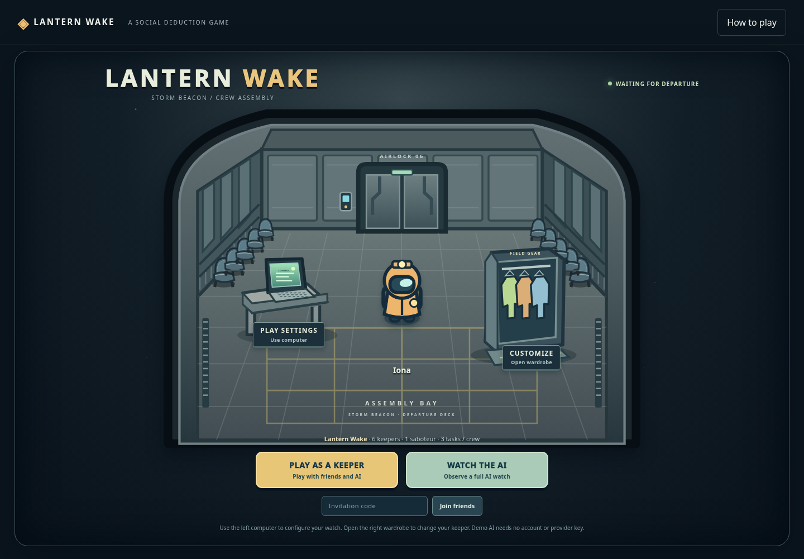
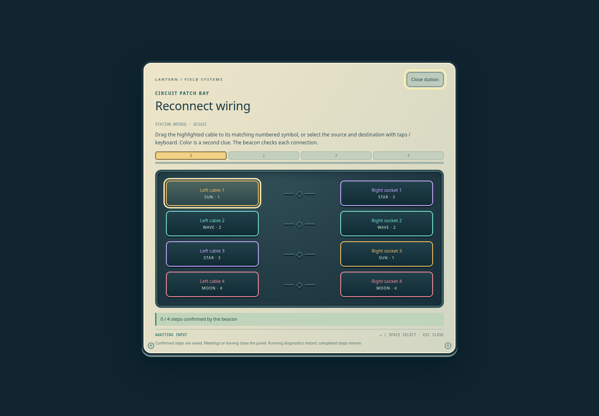
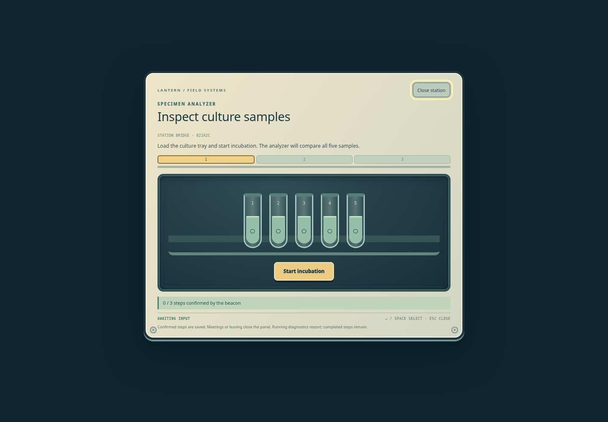

# Detailed tasks and waiting-room qualification

## Final integrated qualification — 2026-10-30

**Runtime source `37a899e73fe6239a9b27ad23c80b9f966989aac1` incorporates main `668a867e069c7fb3aafbc69bbf9e6c42d1607eb7`. All implementation files were unchanged throughout the final browser qualification.** The subsequent `0180a5b` commit changes only the independent browser fixture: it waits for the confirmed ballot before advancing its artificial clock, preventing a vote/deadline race. No runtime source changed for that fix. Documentation/evidence updates follow these commits.

Six requested subagents covered reference research, authoritative task mechanics, task UI, the waiting room, customization, and independent QA. Later integration retained the expanded maps, spatial replay, spectator controls, movement optimization and illustrated map revisions already merged into main. Original feature reports and metadata remain intact.

| Command | Observed result |
| --- | --- |
| `npm ci --ignore-scripts --no-audit --no-fund --cache /workspace/.npm-cache` | 25 packages installed; manifests/lockfile remain consistent. The writable cache is required by this Cloud filesystem. |
| `npm run check` | 172 JavaScript modules syntax checked. |
| `npm test` | **800 tests: 794 passed, 6 existing optional skips, 0 failed, 0 cancelled.** |
| `npm run test:tasks:browser` | **98 checks passed**: all 25 edition-3 families, real controls/server acknowledgement, wrong answers, time gates, real wire/debris dragging, touch/keyboard, remembered-room resume, real settings/profile persistence, and two-station power travel. Uses current revision-2 production geometry. |
| `npm run test:illustrated:browser` | **68 checks passed**: all three illustrated maps, collision/navigation, overview/focus, current geometry, responsive layout and unchanged runtime hashes. |
| `npm run test:maps:browser` | **39 checks passed**: both expanded maps, all six historical CAPTCHA types, 60-task fixtures, reload and mobile geometry. |
| `npm run test:spectator:browser` | **50 checks passed**: role-private defaults, explicit AI-only inspection, native object clicks, free/follow cameras, human isolation, all three maps and responsive rendering. |
| `npm run test:browser` | **42 checks passed**: complete human/AI and all-AI watches, all five classic puzzles, council, mobile, role privacy, victory and replay. |
| `npm run test:multiplayer-browser` | **26 checks passed**: two independent human identities plus spectator, 15-player configuration, appearance, movement, reconnects, multi-saboteur victory, rematch/archive and host revocation. |
| `npm run test:features:browser` | **19 checks passed**: real ghost input/tasks, private fallen chat, ward/echo and mobile controls. |
| `npm run test:replay:browser` | **21 checks passed**: attributed spatial replay, scrubbing, following, perspective, ballots, mobile and no gameplay writes. |
| `LW_WORLD_BROWSER=1 node --test tests/world-ui-browser.test.mjs` | **1 test / 19 checks passed**, including task focus, input leases, touch, council, ejection, critical sabotage and replay; browser/server/owned data cleaned up. |

All browser commands used `CHROME_PATH=/workspace/.cloud-setup/bin/chromium-cloud`, ran sequentially, and reported zero page exceptions. The nine suites total **382 checks**. Expected negative API requests (invalid task completion/collision) remain visible in reports, separate from unexpected failures. There were no paid provider calls, deployment, or direct changes to main.

### Retained evidence

Reports: [25-family tasks](task-depth/reports/tasks.json), [illustrated maps](task-depth/reports/illustrated.json), [expanded maps/CAPTCHA](task-depth/reports/maps.json), [spectator](task-depth/reports/spectator.json), [complete gameplay](task-depth/reports/world.json), [multiplayer](task-depth/reports/multiplayer.json), [ghost/abilities](task-depth/reports/features.json), [spatial replay](task-depth/reports/replay.json), [independent UI](task-depth/reports/independent-ui.json). These are copies of the actual generated reports, including source revisions and fixture metadata. Private `_artifacts` paths in them identify the original captures; portable screenshots are committed below.

[Desktop waiting room](task-depth/screenshots/01-waiting-room-desktop.png) · [Computer settings](task-depth/screenshots/02-watch-computer.png) · [Wardrobe](task-depth/screenshots/03-wardrobe.png) · [390px lobby](task-depth/screenshots/04-waiting-room-mobile-390.png) · [320px lobby](task-depth/screenshots/04-waiting-room-mobile-320.png)

[Wiring](task-depth/screenshots/05-panel-wires.png) · [Glyph CAPTCHA](task-depth/screenshots/06-mobile-glyphs.png) · [Code CAPTCHA](task-depth/screenshots/05-panel-code.png) · [Course plotting](task-depth/screenshots/05-panel-course.png) · [Steering](task-depth/screenshots/06-mobile-steering.png) · [Shields](task-depth/screenshots/05-panel-shields.png) · [Data transfer](task-depth/screenshots/05-panel-transfer.png) · [Sample inspection](task-depth/screenshots/05-panel-sample.png) · [Pairs](task-depth/screenshots/05-panel-pairs.png) · [Waveforms](task-depth/screenshots/05-panel-frequency.png) · [Path CAPTCHA](task-depth/screenshots/05-panel-path.png)







### Scope and compatibility audit

- New configurable watches use 12 equipment and 13 local CAPTCHA families, with deterministic variants and real semantic validation. Tasks, progress, timers, ownership, receipts and logical match identity remain server-owned. Display animations never grant completion.
- Increasing memory rounds require the full prefix; wires match shuffled positions with distinct numbered symbols; power is diverted and accepted at different server-selected stations. Timed samples persist across leaving, while movement/council interrupts active transfer/diagnostic work. Deliberately shorter timers and original equipment visuals are documented in [mechanics](TASK-DEPTH-MECHANICS.md); this is an original adaptation, not a claim of exact Among Us parity or external CAPTCHA security.
- `/` always opens the waiting room, with a left gray-table computer, right wardrobe and separate play/watch options. Computer settings, map, task variety and profile are applied through real room APIs. **Resume your watch** reconnects the stored identity; `/r/:id` links still reconnect directly.
- Classic version-1/version-2 tasks are not rewritten. Existing rooms/replays without map revision keep historical geometry. Tests exercise 4/6/15 actors on all three maps and both revisions, collision-safe p1–p15 spawns, strict save/reload, custom speed/vision and private multi-saboteur information.
- Group invitations, readiness, serialized controls, rematch generations, stale HTTP/WS/AI fences, uncertain reservations and deployment-day budgets remain covered by the retained multiplayer suites.
- The incoming AI inspector is now explicitly consented per identity, only when the match contains no human actors. Default HTTP/WS views contain no private inspection. Mixed-human WATCH rooms reject inspection; rematches clear consent. This preserves the earlier role-privacy requirement while retaining the optional all-AI observatory.

### Findings corrected during verification

Actual browser/independent review found and corrected wire-position mapping, radio keyboard navigation, landscape scene collapse, readonly select-type assignment, course-point active-transform displacement, and timed-control focus loss. New regressions cover these seams. Dynamic replay work also corrected hard-coded six-actor reconstruction, per-match speed/vision, and power-routing reconstruction.

Older browser fixtures were updated deliberately for current accessible labels, explicit start controls, explicit inspection consent, configured task quantities and geometry revisions. The independent ejection fixture now waits for the server-confirmed vote before advancing its fake clock. Native object-click tests wait for an unobscured bell instead of clicking through an overlapping keeper. Assertions still require real input, real engine outcomes and the actual selected object; no required assertion or suite was disabled. Earlier failed/intermediate runs remain separate from the final successful reports.

### External access limits

The requested live Among Us wiki pages returned proxy **403 Forbidden**. [Research notes](TASK-REFERENCE-RESEARCH.md) cite the requested URLs and clearly distinguish prior knowledge from retrieved evidence; this work does **not** claim the live wiki was successfully checked. A Cloud configuration draft adds `among-us.fandom.com` and `among-us.wiki` while preserving the prior GitHub API request. Saving the draft does not apply or publish it; activation requires review/save and publication in environment settings.

Git fetch/push is available. PR creation remains blocked by the enforced policy excluding `api.github.com`; no PR URL is claimed without successful creation. Source is on `codex/multiplayer-configurable-lobbies`, and a reviewable PR body is saved in the Cloud workspace.

## Earlier integration evidence

The task extension is checked independently of its task-engine and UI builders. All fixtures use local or mocked providers. No paid calls, deployment or changes to main are part of qualification.

## Independent automated audit

```sh
node --test tests/task-depth-audit.test.mjs
CHROME_PATH=/workspace/.cloud-setup/bin/chromium-cloud node scripts/task-depth-browser-check.mjs
```

`tests/task-depth-oracle.mjs` interprets the public challenge display independently; the audit does not call the engine's `taskInput` answer function. The unit suite covers every edition-3 family, rejects wrong/future inputs and direct completion, exercises duplicate receipts and real semantic completion, checks private HTTP-view shapes, and validates intermediate snapshots. Additional scenarios cover strict disk save/reload at 4, 6 and 15 keepers, byte-preserving checkpoint reads, no quarantine of valid data, server-timed sample incubation, interrupted transfers and fabricated progress metadata.

The browser fixture covers the actual launch app and its native computer/wardrobe controls, settings and profile persistence into a real authenticated room, play/watch choices, mobile widths, and the actual task panel module against the real transport, engine and private store. Each exhaustive task-family scenario deliberately selects the first human task's kind **before match start** and places its station at Bridge. The human follows legal navigation to that station. An isolated test-only panel host mounts the production component using only the authenticated owner's safe view and submits real HTTP actions. Accepted server snapshots are the only progress source. This design gives every family deterministic coverage without pretending random task generation produced a particular entire catalogue for one keeper.

The driver exercises real wire dragging, debris dragging into the collection chute, keyboard radio/steering sliders, visible memory playback with complete prefix entry, native touchscreen selection on mobile panels, wrong-input rejection, truthful timer locks, close/reopen persistence and server completion acknowledgements. It also checks that the task panel source hashes do not change during a run. The two-stage power scenario follows the updated task location to its distinct acceptance station. Broader world-app lifecycle, socket ownership, gameplay outcomes, map geometry and replay remain covered by the existing integrated suites rather than inferred from the isolated panel host.

## Observed integration run

On 2026-10-30, the first independent node audit passed **30 tests, zero failures/skips**. An exhaustive browser run passed **94 checks across all 25 families**, with **zero browser exceptions**, against the in-progress integration tree. Its source commit field records `61a1180` plus the modified paths; it is not represented as a clean final-commit run. Panel hashes stayed unchanged for that run. Reports and 19 screenshots are under `_artifacts/task-depth-browser-Kt3sHw/`.

That run found a real pointer defect before the passing result: a generic active-button transform displaced absolute course points between pointer-down and pointer-up. The fix preserves the course/debris anchor transform, and the subsequent run completed course and debris controls successfully. A separate initial driver timeout was a fixture wait mistake: a panel host polling every 100 ms cannot reach Puppeteer's `networkidle0`; the driver now waits for DOM readiness and the actual panel.

After this integration run, the builders improved the truthful steering preview and changed power diversion to require a distinct station. The driver and independent oracle tests were adapted for those changes. The coordinator's final frozen-source run and consolidated qualification supersede the intermediate counts above; do not claim those later changes were covered by this earlier capture.

## Reference and interpretation

[Task reference research](TASK-REFERENCE-RESEARCH.md) records the requested Among Us wiki URLs and distinguishes retrieved source evidence from inaccessible pages and established mechanics. Wiki requests were blocked by the Cloud network policy, so this work does not claim the live wiki was successfully inspected. Lantern Wake uses original equipment artwork and game-specific labels. Countdown durations, task counts and some panel representations are deliberate adaptations; these are not third-party CAPTCHA services or claims of exact Among Us visual assets.
