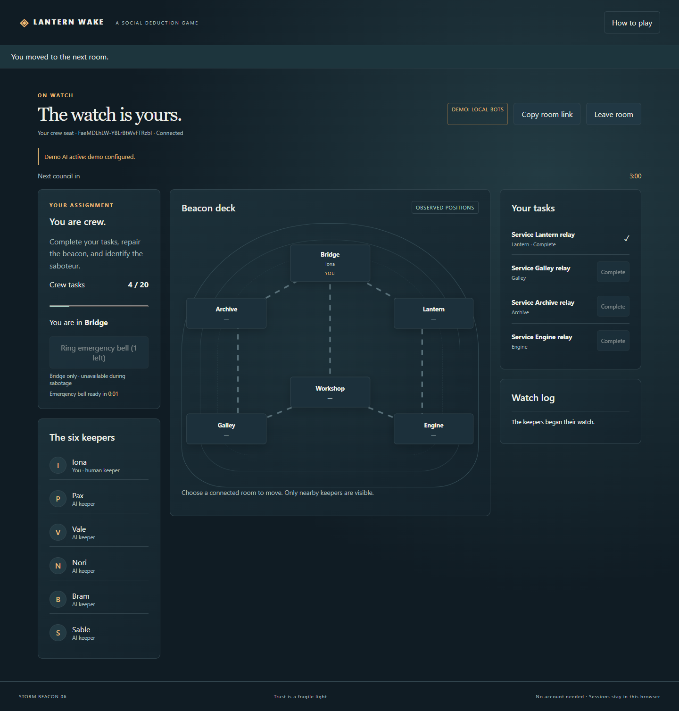

# Lantern Wake verification

The integrated application is playable in human-plus-AI and six-AI spectator modes. Qualification used Node24.20.0 and Chrome156.0.8078.73 on Windows, with source, fixtures and artifacts on D:. No paid/live provider request or deployment was performed.

## Final results

| Check | Observed result |
| --- | --- |
| Locked clean install | `npm ci --ignore-scripts --no-audit --no-fund`:25 packages installed |
| Complete offline suite | `npm test`:160 tests,156 passed, four opt-in skips, zero failures after bounded test concurrency |
| Syntax preparation | `npm run check`:40 JavaScript modules passed; no separate build is needed |
| Integrated real Chrome workflow | `npm run test:browser`:16 named checks passed;484 HTTP/WebSocket room payload privacy checks; zero runtime, console or cleanup errors |
| Default-clock CLI match | Actual `npm start`, standard rules, unseeded demo AI, no clock override:discussion at22.5s, voting at52.8s, crew task victory and full replay at72.9s; zero model calls |
| Independent complete UI scenario | One passing real-backend browser subtest plus26 supplemental named checks, including111 inspected HTTP/WS views;10 UI unit/DOM tests passed |
| Independent repair/privacy closure | Nine current controls pass; original leaking event fails the same intended assertion |
| Process ownership | Nine transport owner controls and five independent startup scenarios pass, including real competing child processes |
| Final spending boundary |12 independent closure controls pass against c77f283; no remaining concrete finding in tested scope |
| Terminal AI work | Three independent real HTTP/deadline/restart controls pass; ending or pausing aborts pending AI and preserves uncertain reservations |

Counts overlap and must not be added into a unique coverage total. Historical budget regression suites intentionally reproduce defects in old committed source; their green results do not claim those old sources were correct. The four normal-suite skips are opt-in source-review/browser suites exercised separately; no failed assertion is counted as a skip.

The main browser report pins clean source `9b31317c618ea12810a369edb84f87834f9218b9`, with no modified tracked paths. Engine, AI, rooms, store, budget, public assets and shared contracts are unchanged afterward. Later changes improve launch text, isolate fresh QA output, make audit paths portable, bound test concurrency and add evidence/docs. The terminal-cancellation delta at9b was independently reviewed after its real browser pass. The last bounded integration suite runs at2cdbe78.

A second, freshly created checkout at `D:/Widegames-work/qualification`, detached at `04d636b`, installed25 packages from the lockfile with `npm ci --ignore-scripts --no-audit --no-fund`. Its ordinary `npm test` also passed **160 total /156 pass /four opt-in skips**, zero failures,18.957 seconds; `npm run check` passed all40 modules. Both checkout working trees were clean afterward. This separately exercises the real install and tests from a differently named directory, including the correction that removes a worker-specific sibling-path dependency. Log: coordinator `_artifacts/fresh-directory-tests.txt`.

Reports: [real browser](browser-qualification.json), [unaccelerated default match](default-clock-match.json). All matches in screenshots below are clearly labeled local **demo**; they are seeded and use accelerated qualification rules. The default-clock report is a separate unseeded standard match.

## Actual screenshots

[Desktop harbor](screenshots/desktop.png), [human gameplay](screenshots/gameplay.png), [mobile spectator](screenshots/mobile.png), [victory and replay](screenshots/replay.png).



## Workflows exercised

The browser creates a room, fills AI seats, starts the real engine, receives only the human's private role, moves through connected rooms, completes a real task, calls council, types while actual WebSocket updates arrive, sends markup-like dialogue as plain text, votes/skip-votes, restores the same cookie-authenticated seat after reload, completes the match and loads attributed replay. An independent browser context joins as spectator and cannot act. A second six-AI match reaches its engine-defined outcome. Both320px and390px layouts fit without horizontal overflow.

The supplemental frontend run also exercises actual tab hiding/foregrounding, socket closure and HTTP fallback, unsent draft/selection preservation, spectator reload without another join, named ballots and readable role-revealed replay. The comprehensive UI scenario performs saboteur elimination confirmation, elimination, local body reporting, critical sabotage and crew repair through real routes. These are explicitly seeded engine preconditions; no fake HTTP response or model output supplies a winner.

Ordinary engine tests reach every victory condition through legal actions and cover ties, skipped/missing votes, cooldowns, emergency limits, dead actors, missed deadlines, critical countdowns through meetings, private view equivalence and duplicate/conflicting request IDs. Real transport tests cover HTTP/WS authorization, room isolation, reconnection, simultaneous mutations, restart retention, request/body limits and spending/storage failure boundaries. Provider tests mock the fixed official API, validate structured tools and enforce budgets, retries, cancellation and explicit demo fallback. Live requests never receive a complete hidden state.

## Independent corrections and preserved failed runs

| Finding | Final correction / evidence |
| --- | --- |
| AI ID namespace mismatch and evicted request replay |01c26be:compatible bounded IDs; retain up to2,048 identities per actor, then reject new requests; old requests remain inert |
| Later AI seats starved and HTTP denials not persisted |01c26be plus transport milestone:earliest-due scheduling; save engine denial/deadline state before error |
| Witness evidence tied with inferred suspicion; identical demo voices |3b8fc3d /5ca4131:separate firsthand evidence, prioritize it, distinct persona templates |
| Concurrent stale-lock recovery could admit two writers |4b71441 /0908f28:exclusive recovery claim with PID/token checks; independent real-child races qualify single ownership |
| Negative/decimal reservation accounting, unsynced writes, incompatible canonical restore and oversized acknowledged ledger |c38d1f9,4f9f22f,c77f283:strict integer ceilings, compatible v1 read/v2 write, file sync, common read/write byte bound |
| Unseen repair actor revealed crew identity/location |c99e309:aggregate progress only; actor attribution remains in ended replay |
| Pending AI could continue after ending/pausing |9b31317:abort at terminal broadcast; reject post-terminal reservations; preserve already reserved uncertain spend |

Independent receipts: [engine integration](ENGINE-INTEGRATION-REVIEW.md), [AI correction](ENGINE-AI-CLOSURE.md), [final public privacy/lock](ENGINE-FINAL-PRIVACY.md), [budget size closure](AI-BUDGET-SIZE-CLOSURE.md), [terminal AI](TRANSPORT-TERMINAL-AI-REVIEW.md), [complete browser qualification](UI-FINAL-QUALIFICATION.md). Old reports remain unchanged at their exact pins; later closure receipts supersede their open findings.

The coordinator's first browser driver used native disabled-state checks against inspectable `aria-disabled` map buttons and timed out; the actual task had completed. A subsequent driver completed both matches but hung draining an aborted reload response. Both failed invocations are retained under ignored `_artifacts/`; the second owned Node/Chrome tree was explicitly identified and stopped. The corrected driver observes completed HTTP requests, bounds audit draining, closes resources and rejects late errors. The final complete run passes.

One unbounded-parallel offline invocation missed the scheduler fixture's1.2-second host-time allowance and observed five rather than six turns before the assertion. It remains a failed invocation. A ten-second bounded correctness wait, controlled terminal clock and `--test-concurrency=2` remove that incidental performance requirement while retaining the original scheduler's failing negative control. The final complete160-test run passes. This is not a load/performance certification.

## Reproduce

```sh
npm ci
npm test
npm run check
npm run test:browser
```

Use a full Git checkout: pinned historical source audits require their committed objects, so CI fetches full history. Browser qualification uses an installed Chrome and no downloaded browser; set `CHROME_PATH` if needed. It writes a fresh uniquely reserved `_artifacts/browser-*` report/screenshots/profile and stops its own server/browser on completion. No real user profile or production data directory is used. The CI workflow includes both offline and full-browser checks and uploads only report/PNG fixtures, excluding state, credentials and browser profiles.

## External setup and verification limits

Demo needs only Node/npm. Live hybrid council requires an Anthropic API key, access to the pinned Haiku model and billing; the Messages/tool API and pricing were checked against [official API documentation](https://platform.claude.com/docs/en/api/messages/create) and [official model pricing](https://platform.claude.com/docs/en/about-claude/pricing). Actual provider credentials, latency, billing and live cancellation remain unverified; all provider tests were offline mocks.

Public deployment requires an exact `PUBLIC_ORIGIN`, HTTPS/WebSocket reverse proxy and private persistent local data volume. One service/budget writer must own it. Docker configuration is supplied, but Docker was unavailable here and no image build, hosting deployment or live domain was qualified. No hosted Actions pass is asserted. Browser results cover desktop Chromium and responsive layouts, not physical mobile hardware, Safari/Firefox, a screen reader or native IME hardware. Files are synced before atomic replacement, but directory metadata, power loss, storage-controller durability, distributed writers and broad production load are unqualified. Abandoned ambiguous recovery claims intentionally require operator inspection after stopping writers.

The repository began empty. Its first integration-branch push became the default branch. No main base existed, no main branch was created or merged, and no hosting deployment was performed.
