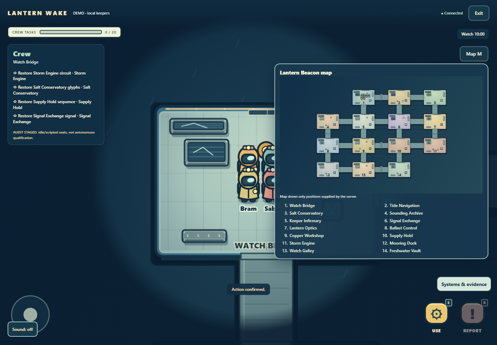
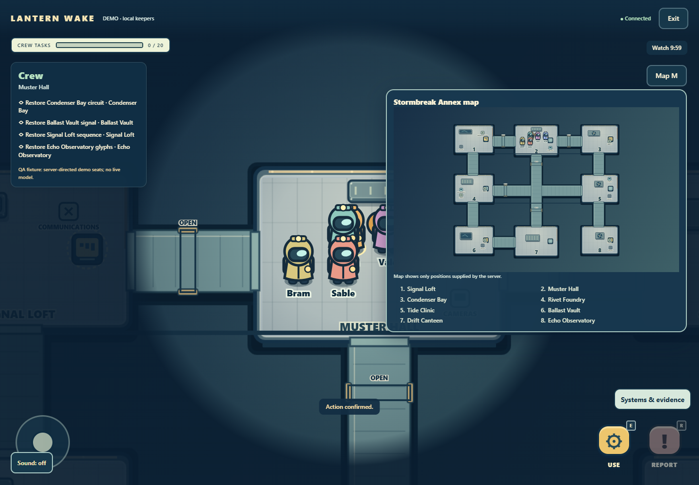

# Lantern Wake screenshots

Actual unedited native Chrome captures from labeled offline fixtures. Eight images are from the final22-check run atf0ea76d; Annex is from the earlier32-check, two-map tactical run at4911f17. Each exact source, original path and PNG SHA256 is in [manifest.json](manifest.json). These are test captures, not live deployment or physical-phone evidence.

The council is intentionally scrolled to the composer; its literal markup message tests text safety. The private message belongs to a synthetic fixture. Role reveals in replay are postgame. Final native execution was by the coordinator after the reviewer account reached quota.

| Capture | Subject |
| --- | --- |
| [beacon-map.png](beacon-map.png) | Original fourteen-room Beacon2 map and numbered room key |
| [beacon-walking.png](beacon-walking.png) | Actual keyboard walking in the Beacon world |
| [glyph-inspection-mobile.png](glyph-inspection-mobile.png) | Owner-only glyph puzzle at390px |
| [pressure-valves.png](pressure-valves.png) | Generated authoritative pressure-order puzzle |
| [council-mobile.png](council-mobile.png) | 320px council scrolled to composer, fixed readable heading/timer |
| [ghost-controls-mobile.png](ghost-controls-mobile.png) | Ghost task controls and collapsed private-chat dock |
| [fallen-chat-mobile.png](fallen-chat-mobile.png) | Actual private fallen-message acknowledgement |
| [spatial-replay.png](spatial-replay.png) | Actual all-AI outcome and role-revealed spatial replay |
| [annex-map.png](annex-map.png) | Original Stormbreak Annex1 from the two-map tactical fixture |

See [verification and limits](../QUALITY-VERIFICATION.md) for exact workflows and source pins.
